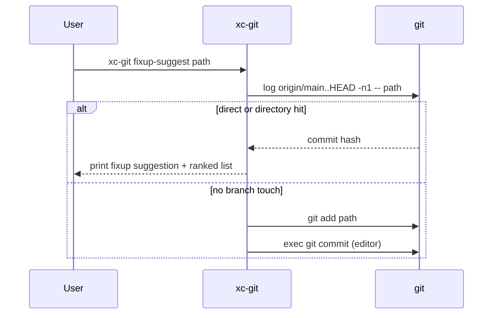

<!-- markdownlint-disable -->
# xc-git — Design

## 1. OVERVIEW

`xc-git` is the unified zsh entrypoint for git terminal helpers previously split across
`xc-git-branch-preview`, `xc-git-fixup-suggest`, and `xc-git-log-fzf`. It uses **subcommand
dispatch** (same pattern as `xc-fabric` and legacy `xc-git-log-fzf` action argument).

Implementation MUST preserve behavior byte-for-byte where practical; refactors are limited to
shared `_git_emit` helper and file split for maintainability.

**Layout:** single package directory `config/bin/xc-git/` (no separate `lib/xc-git/`).

**Why not `lib/xc-git/`?** That split only helps when multiple top-level binaries share the same
library. Here one CLI owns all modules; a second path (`lib/`) duplicates the package name and
complicates symlinks (`~/.local/bin/xc-git` must point at the real executable). Keep every module
next to the dispatcher.

---

## 2. FOLDER STRUCTURE

```tree
config/bin/
  ├── xc-git/                             ← package directory (not a single file at bin root)
  │   ├── xc-git                          ← executable; PATH symlink target
  │   ├── _common.zsh                     ← optional gum (_xc_git_emit)
  │   ├── branch-preview.zsh
  │   ├── fixup-suggest.zsh
  │   └── log-fzf.zsh
  ├── xc-git-branch-preview               ← thin wrapper
  ├── xc-git-fixup-suggest                ← thin wrapper
  ├── xc-git-log-fzf                      ← thin wrapper
  ├── specs/xc-git/
  │   ├── requirements.md
  │   ├── design.md
  │   └── tasks.md
  ├── tests/
  │   ├── xc-git.spec.ts                  ← primary spec (new)
  │   ├── xc-git-fixup-suggest.spec.ts  ← migrate or redirect to xc-git
  │   └── xc-git-log-fzf.spec.ts          ← migrate or redirect to xc-git
  └── mise.toml                           ← add xc-git:specs task
```

**Post-migration:** Remove `config/bin/lib/xc-git/` if present. Wrappers at `config/bin/xc-git-*`
use `exec "${0:h}/xc-git/xc-git" <subcommand> "$@"`.

**Symlink (README):** `ln -s ~/.config/bin/xc-git ~/.local/bin/xc-git`

---

## 3. ARCHITECTURE

### Component diagram

```text
xc-git (dispatcher)
  ├── parse argv[1] subcommand
  ├── -h / --help → top-level or subcommand help
  └── source config/bin/xc-git/<subcommand>.zsh → _xc_git_*_main "$@"

Thin wrappers (3) ──exec──► config/bin/xc-git <subcommand> "$@"

gitx _gitx_fzlog ──► xc-git log-fzf "$@"
gitx _gitx_fzb   ──preview──► xc-git branch-preview {}  (or legacy wrapper)
```

### Sequence: fixup-suggest (happy path)



---

## 4. Subcommand registry

| Subcommand       | Legacy script           | Positional args        | Global flags before `--`                                                   |
| ---------------- | ----------------------- | ---------------------- | -------------------------------------------------------------------------- |
| `branch-preview` | `xc-git-branch-preview` | `<branch>` (required)  | `-h`, `--help` only                                                        |
| `fixup-suggest`  | `xc-git-fixup-suggest`  | `[path...]` after `--` | `-b`, `--base`, `-n`, `--top`, `-q`, `--best`, `--dry-run`, `-h`, `--help` |
| `log-fzf`        | `xc-git-log-fzf`        | `[action]` optional    | `-h`, `--help` only                                                        |

**Top-level usage (stdout):**

```text
xc-git - Git helpers (branch preview, fixup suggest, log fzf)

Usage:
  xc-git <subcommand> [options] [args...]

Subcommands:
  branch-preview <branch>     fzf branch preview (gum + delta)
  fixup-suggest [opts] [-- paths]   safe fixup target or new commit
  log-fzf [action]            interactive git log (fzf + gitx)

  xc-git -h | --help

Run 'xc-git <subcommand> -h' for subcommand help.
```

### Dispatcher algorithm

1. `readonly XC_GIT_DIR="${${(%):-%x}:a:h}"` — package dir (`config/bin/xc-git/`), same directory as the `xc-git` executable.
2. Top-level `-h` / `--help`: handled before subcommand (see §4.2); no git repo required.
3. If no subcommand after parse → print usage; exit 1.
4. `subcommand=$1`; shift.
5. Explicit dispatch (source sibling `.zsh` files):

```zsh
case "$subcommand" in
  branch-preview) source "${XC_GIT_DIR}/branch-preview.zsh"; _xc_git_branch_preview_main "$@" ;;
  fixup-suggest)  source "${XC_GIT_DIR}/fixup-suggest.zsh";  _xc_git_fixup_suggest_main "$@" ;;
  log-fzf)        source "${XC_GIT_DIR}/log-fzf.zsh";        _xc_git_log_fzf_main "$@" ;;
  *)
    echo "xc-git: unknown subcommand: ${subcommand}" >&2
    _xc_git_usage >&2
    exit 1
    ;;
esac
```

6. `_xc_git_usage` greps `#?` from `"${XC_GIT_DIR}/xc-git"` (the executable file).

7. Each `*_main` sets `set -euo pipefail` and sources `"${XC_GIT_DIR}/_common.zsh"` when needed.

### 4.1 Shared optional gum (`_common.zsh`)

Sourced at the top of `branch-preview.zsh` and `fixup-suggest.zsh` (not `log-fzf.zsh`).

```zsh
# config/bin/xc-git/_common.zsh — optional gum styling (Req-9)

typeset -g _XC_GIT_HAS_GUM=-1

_xc_git_has_gum() {
  if ((_XC_GIT_HAS_GUM >= 0)); then
    return "$_XC_GIT_HAS_GUM"
  fi
  if command -v gum >/dev/null 2>&1; then
    _XC_GIT_HAS_GUM=0
  else
    _XC_GIT_HAS_GUM=1
  fi
  return "$_XC_GIT_HAS_GUM"
}

# Print a section heading; gum when interactive + available, else plain text.
_xc_git_emit() {
  local fg="$1" text="$2"
  if _xc_git_has_gum && [[ -t 1 ]]; then
    gum style --foreground "$fg" --bold "$text" 2>/dev/null || print -r -- "$text"
  else
    print -r -- "$text"
  fi
}
```

**Foreground colors (unchanged from legacy scripts):**

| Use                                   | `gum` foreground code |
| ------------------------------------- | --------------------- |
| Path list / diff heading              | `212`                 |
| Per-path suggestion / history heading | `39`                  |

**Migration from fixup-suggest:** delete local `_has_gum` / `_xcf_emit`; call `_xc_git_emit` instead.

**Migration from branch-preview:** replace bare `gum style` calls with `_xc_git_emit 212 "…"` and `_xc_git_emit 39 "…"`.

**Dependencies line for README:** `gum` optional; `fzf` required only for `log-fzf`; `delta` required for `branch-preview` diff section.

### 4.2 CLI argument parsing (`zparseopts`, not mise `usage`)

#### Evaluation: [mise `usage` field](https://mise.jdx.dev/tasks/task-arguments.html)

| Aspect                         | Verdict                                                                                           |
| ------------------------------ | ------------------------------------------------------------------------------------------------- |
| **Purpose**                    | Declares arguments for **`mise run <task>`**; exposes `usage_*` env vars in the task `run` script |
| **xc-git on PATH**             | Users invoke `xc-git`, `git lol`, `gitx fzl`, fzf previews — **not** via `mise run`               |
| **File-task `#USAGE` headers** | For mise **file tasks** executed by mise; same limitation for a standalone zsh binary             |
| **Conclusion**                 | **Do not** use mise/`usage` CLI for runtime parsing of `xc-git`                                   |

**Correct use of mise `usage` in this project:** only in `config/bin/mise.toml` for **`xc-git:specs`** (`flag "--scenario <scenario>"` with `choices`), same as `xc-fabric:specs`.

#### Chosen approach: Zsh `zparseopts` (reference: `config/zsh/etc/functions/psc`, `osx`)

- **Dispatcher:** optional top-level `-h` / `--help` only; subcommand remains first positional after flags (`zparseopts -D -E`, no `-F` on dispatcher so unknown flags before subcommand are not consumed — OR use `-F` only when no subcommand yet; simplest: if `$1` is `-h`/`--help` before subcommand, help; else `subcommand=$1`).
- **`fixup-suggest`:** MUST use `zparseopts -D -F -E -A opts` per psc pattern for `-b`, `--base`, `-n`, `--top`, `-q`, `--best`, `--dry-run`, `-h`, `--help`; then `typeset -a _path_args=("$@")` for remaining positionals; `--` ends options (`-E` stops at first non-option; explicit `--` case still supported if passed through).
- **`branch-preview`:** `zparseopts -D -F -E -A opts h=help -help=help`; require one positional branch name.
- **`log-fzf`:** keep lightweight `case "${1:-}" in -h|--help)` (single optional action positional; adding `zparseopts` adds little value).

**Help:** continue `#?` grep + `sed` (xc-bin convention), not `show_usage` / `##?` (zsh autoload functions use `##?` per `psc`).

**Reference implementation (fixup-suggest):**

```zsh
local -A opts=()
zparseopts -D -F -E -A opts \
  b:=base -base:=base \
  n:=top -top:=top \
  q=best -best=best \
  -dry-run=dry_run \
  h=help -help=help || return 1

# With -A, keys are literal flags: -h, --help, -q, --dry-run, -b, --base, …
if (( ${+opts[-h]} )) || (( ${+opts[--help]} )); then
  _xc_git_fixup_usage; return 0
fi
_base_ref="origin/main"
_top_n=10
(( ${+opts[--base]} )) && _base_ref="${opts[--base]}"
(( ${+opts[-b]} )) && _base_ref="${opts[-b]}"
(( ${+opts[-q]} )) || (( ${+opts[--best]} )) && _quiet=1
(( ${+opts[--dry-run]} )) && _dry_run=1
typeset -a _path_args=("$@")
```

Boolean flags: test `(( ${+opts[-q]} ))` / `(( ${+opts[--dry-run]} ))` (not `opts[help]` — see `psc` which checks `opts[-h]` / `opts[--help]`).

---

## 5. Subcommand: branch-preview

**Entry:** `_xc_git_branch_preview_main "$@"`

**Behavior:** Copy current `xc-git-branch-preview` body with these edits:

- `source "${XC_GIT_DIR}/_common.zsh"` before output.
- Parse `-h`/`--help` with `zparseopts` per §4.2.
- All `gum style` headings → `_xc_git_emit` per §4.1.
- Help via `#?` in `config/bin/xc-git/branch-preview.zsh`.

**Dependencies:** `git`, `delta` (diff section); `gum` optional via §4.1.

**fzf contract (gitx):**

```text
--preview 'xc-git branch-preview {}'
```

Legacy equivalent: `xc-git-branch-preview {}` via wrapper.

---

## 6. Subcommand: fixup-suggest

**Entry:** `_xc_git_fixup_suggest_main "$@"`

**Behavior:** Copy current `config/bin/xc-git-fixup-suggest` logic into
`config/bin/xc-git/fixup-suggest.zsh` with these edits:

| Legacy                                | Unified                                                    |
| ------------------------------------- | ---------------------------------------------------------- |
| `xc-git-fixup-suggest:` stderr prefix | `xc-git fixup-suggest:`                                    |
| `XC_SCRIPT`                           | `XC_GIT_FIXUP_SCRIPT` (path to sourced file for `#?` help) |
| `_usage`                              | `_xc_git_fixup_usage`                                      |
| `_has_gum` / `_xcf_emit`              | remove; use `_common.zsh` `_xc_git_emit`                   |
| `while/case` option loop              | replace with `zparseopts` per §4.2                         |

**Defaults (closed):**

| Option          | Default       |
| --------------- | ------------- |
| `--base` / `-b` | `origin/main` |
| `--top` / `-n`  | `10`          |
| `-q` / `--best` | off           |
| `--dry-run`     | off           |

**Range:** `${_base_ref}..HEAD`

**Exit codes:**

| Code | Condition                                                                                              |
| ---- | ------------------------------------------------------------------------------------------------------ |
| 0    | Success; or no uncommitted paths (no args mode); or `--dry-run` new-commit path                        |
| 1    | Not a repo; bad base ref; no commits in range; no paths from args; `-q` with no target; path not found |

**Quiet stdout:** single short hash line only, no trailing newline required beyond `git rev-parse --short`.

**New commit path:** `git add -- "${_new_commit_paths[@]}"` then `exec git commit` (no `-m`; editor opens).

---

## 7. Subcommand: log-fzf

**Entry:** `_xc_git_log_fzf_main "$@"`

**Behavior:** Copy current `xc-git-log-fzf` into `config/bin/xc-git/log-fzf.zsh`.

**gitx path (closed):**

```text
${XDG_CONFIG_HOME:-$HOME/.config}/zsh/etc/functions/gitx
```

**Allowed `<action>` values (first positional):**

`rebase-from`, `fix`, `reword`, `edit`, `drop`, `reset-soft`, `reset-hard`

**Exit codes:**

| Code | Condition                 |
| ---- | ------------------------- |
| 0    | Help; empty fzf selection |
| 127  | gitx file missing         |

**Enter without action:** pipe selection through `zsh "$local_gx" grep-commit` (unchanged).

---

## 8. Thin wrappers

Each legacy top-level script becomes:

```zsh
#!/usr/bin/env zsh
#? xc-git-branch-preview - Deprecated wrapper; use: xc-git branch-preview
exec "${0:h}/xc-git/xc-git" branch-preview "$@"
```

`"${0:h}/xc-git/xc-git"` is authoritative (works without PATH). `command -v xc-git` MAY be used
after install symlinks `~/.local/bin/xc-git` → `~/.config/bin/xc-git`.

---

## 9. External integration

### gitx `_gitx_fzlog` (edit `config/zsh/etc/functions/gitx`)

Replace helper resolution block (lines ~558–568) with:

```zsh
_gitx_fzlog() {
  local helper
  if command -v xc-git >/dev/null 2>&1; then
    xc-git log-fzf "$@"
    return $?
  fi
  if command -v xc-git-log-fzf >/dev/null 2>&1; then
    command xc-git-log-fzf "$@"
    return $?
  fi
  helper="${XDG_CONFIG_HOME:-$HOME/.config}/bin/xc-git-log-fzf"
  if [[ ! -x "$helper" ]]; then
    echo "gitx: install xc-git on PATH (symlink from config/bin) — missing log-fzf helper" >&2
    return 127
  fi
  command "$helper" "$@"
}
```

### gitx `_gitx_fzb` preview (optional doc-only change)

Current: `--preview 'xc-git-branch-preview {}'`

MAY update to `xc-git branch-preview {}` in a follow-up commit; wrapper preserves old string.

---

## 10. Testing contract

**Env var:** `XC_GIT` = absolute path to `config/bin/xc-git` (executable inside package dir)

**Spawn pattern:**

```typescript
Bun.spawnSync(["zsh", script, "fixup-suggest", "--dry-run", ".gitattributes"], { cwd: repoRoot, ... });
```

**Scenarios (`usage_scenario` / mise `--scenario`):**

| ID             | Covers                                           |
| -------------- | ------------------------------------------------ |
| `help`         | top-level + subcommand help                      |
| `missing_git`  | fixup-suggest outside repo                       |
| `missing_gitx` | log-fzf without gitx                             |
| `paths_arg`    | fixup-suggest dry-run + README path with history |
| `dispatch`     | unknown subcommand exit 1                        |
| `wrappers`     | legacy names exec to same exit as xc-git         |

**mise task:**

```toml
"xc-git:specs" = { description = "Bun specs for xc-git", dir = "{{ config_root }}",
  env = { XC_GIT = "{{ config_root }}/xc-git" },
  usage = '''flag "--scenario" { choices "help" "missing_git" "missing_gitx" "paths_arg" "dispatch" "wrappers" }''',
  run = "bunx bun test tests/xc-git.spec.ts" }
```

Keep `xc-git-fixup-suggest:specs` as alias running same tests OR deprecate in README after merge.

---

## 11. README updates (`config/bin/README.md`)

- Replace three example names with `xc-git` in EXAMPLES list; keep `xc-git-stash-preview` unchanged.
- Add dedicated section **### xc-git** with:

| Subcommand       | Purpose                           | Example                                  |
| ---------------- | --------------------------------- | ---------------------------------------- |
| `branch-preview` | fzf branch preview (gum + delta)  | `xc-git branch-preview main`             |
| `fixup-suggest`  | Safe fixup target or `git commit` | `xc-git fixup-suggest --dry-run -- path` |
| `log-fzf`        | Interactive log + gitx keys       | `xc-git log-fzf fix`                     |

- Document legacy wrappers (`xc-git-branch-preview`, etc.) as `exec xc-git …`.
- **Dependencies:** `gum` optional (section headings); `fzf` for `log-fzf`; `delta` for `branch-preview` diff.
- Add `mise run xc-git:specs` section; deprecate separate fixup/log mise tasks in prose (may keep aliases one release).

---

## 14. Documentation and integration

### 14.1 Root `README.md`

Insert new subsection after **USAGE** (before **BUILDING** or after **DEPENDENCIES** — implementer picks the clearer flow; default: after `### DEPENDENCIES`, before `## USAGE` → use **`## USAGE` → `### Terminal helpers (config/bin)`** as first USAGE child).

**Required content (markdown table + examples):**

```markdown
### Terminal helpers (config/bin)

Scripts live in `config/bin/` (symlinked to `~/.local/bin`). Git workflow helpers are unified as **`xc-git`**:

| Command                                  | What it does                                                                                    |
| ---------------------------------------- | ----------------------------------------------------------------------------------------------- |
| `xc-git branch-preview <branch>`         | Preview branch tip, history, and last diff (for fzf; used by `git fzb` / `gitx fzb`)            |
| `xc-git fixup-suggest [opts] [-- paths]` | Pick latest branch commit that touched each path for `git fix`, or open editor for a new commit |
| `xc-git log-fzf [action]`                | Interactive `git log` with gitx actions (`git lol`, `git fzl`, `gitx lol`)                      |

```sh
xc-git -h
xc-git fixup-suggest --dry-run .
git add file && git fix "$(xc-git fixup-suggest -q -- file)"
git lol          # → gitx → xc-git log-fzf
git fixup-suggest -- .gitattributes
dots git         # same as xc-git -h
```

More detail: [config/bin/README.md](config/bin/README.md).
```

### 14.2 `config/git/config`

**Edit comment blocks only** (alias lines stay `gitx` unless noted):

| Alias block             | Add to comment (above alias)                                                         |
| ----------------------- | ------------------------------------------------------------------------------------ |
| `fix` / `fix-all`       | Note pairing with `xc-git fixup-suggest -q` to choose target safely before `git fix` |
| `lol` / `fzlog` / `fzl` | Implementation: `gitx` → `xc-git log-fzf`                                            |
| `fzb`                   | Branch preview: `xc-git branch-preview` via gitx fzf `--preview`                     |

**New alias** (insert after `fix-all` block, ~line 512):

```gitconfig
# Suggest fixup target from branch history, or open commit editor (no guess commits).
# @example: git fixup-suggest
# @example: git fixup-suggest --dry-run -- .gitattributes
# @example: git add . && git fix "$(xc-git fixup-suggest -q -- .)"
fixup-suggest=!xc-git fixup-suggest
```

Requires `xc-git` on `PATH` (install symlinks `~/.local/bin/xc-git`).

### 14.3 `config/zsh/etc/functions/gitx`

1. **`_gitx_fzlog`** — per §9.
2. **`_gitx_fzb`** — update `--preview` to prefer:

   ```text
   --preview 'xc-git branch-preview {}'
   ```

   (wrapper keeps `xc-git-branch-preview {}` valid.)
3. **`#?` help block** — append under Commands (after `fzb` / `lol` lines):

   ```text
   #?   (implementation) lol/fzl/fzlog → xc-git log-fzf; fzb preview → xc-git branch-preview
   #?   fixup-suggest: use `xc-git fixup-suggest` or `git fixup-suggest` (not a gitx subcommand)
   ```

### 14.4 `config/zsh/etc/functions/dots`

Add docopt entry and dispatcher branch:

**`##?` block additions:**

```text
##?     git [args...]          xc-git helpers (-h or forward to xc-git).
##? Examples:
##?     dots git
##?     dots git fixup-suggest --dry-run .
```

**Case handler** (inside main `case` for first argument):

```zsh
git)
  if [[ $# -lt 2 ]] || [[ "${2:-}" == "-h" || "${2:-}" == "--help" ]]; then
    command -v xc-git >/dev/null 2>&1 && xc-git -h || {
      echo "dots git: xc-git not on PATH" >&2; exit 127
    }
  else
    command -v xc-git >/dev/null 2>&1 && xc-git "${@:2}" || {
      echo "dots git: xc-git not on PATH" >&2; exit 127
    }
  fi
  ;;
```

No new fixup/logic in `dots` beyond forwarding.

---

## 12. Error message prefix standard

All new stderr from unified code: `xc-git <subcommand>:` (one space after colon message).

---

## 13. Implementation constraints

- Shebang: `#!/usr/bin/env zsh` on all executables.
- No sourcing `~/.zshrc`.
- `shellcheck` on dispatcher, wrappers, and lib files (where applicable).
- Do not change fixup algorithm or log-fzf bind strings in this merge.
- Documentation edits in §11 and §14 are part of the same PR as code (Req-8).

---

## 15. Files touched checklist (implementation PR)

| File                              | Change                 |
| --------------------------------- | ---------------------- |
| `config/bin/xc-git`               | Dispatcher executable  |
| `config/bin/xc-git/_common.zsh`   | `_xc_git_emit` (Req-9) |
| `config/bin/xc-git/*.zsh`         | Subcommand modules     |
| (delete) `config/bin/lib/xc-git/` | No parallel lib tree   |
| `config/bin/xc-git-*` (3)         | Thin wrappers          |
| `config/bin/tests/xc-git.spec.ts` | New specs              |
| `config/bin/mise.toml`            | `xc-git:specs`         |
| `config/bin/README.md`            | §11                    |
| `README.md` (repo root)           | §14.1                  |
| `config/git/config`               | §14.2                  |
| `config/zsh/etc/functions/gitx`   | §9 + §14.3             |
| `config/zsh/etc/functions/dots`   | §14.4                  |
