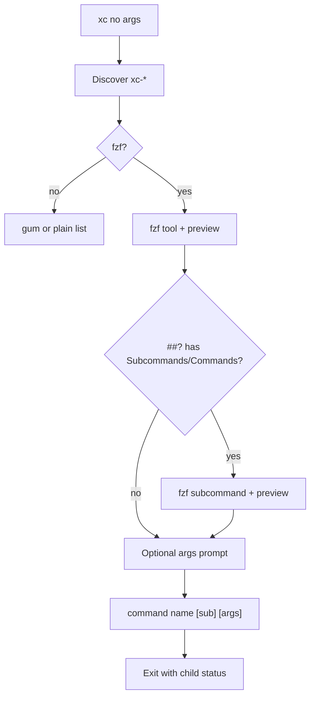

<!-- markdownlint-disable -->
# xc — Launcher design

## 1. OVERVIEW

### 1.1 What stays separate (important)

**`xc` is only a launcher.** It does **not** replace or merge the other tools. Each remains its
own file on disk:

| Script                 | Role                                            |
| ---------------------- | ----------------------------------------------- |
| `config/bin/xc-fabric` | Fabric runner                                   |
| `config/bin/xc-git`    | Git helpers (dispatcher + subcommands)          |
| `config/bin/xc-puts`   | Formatted output                                |
| `config/bin/xc-skills` | Skills tooling                                  |
| `config/bin/xc-toast`  | Terminal toast                                  |
| `config/bin/xc-usage`  | Help extraction (`##?`)                         |
| **`config/bin/xc`**    | **NEW** — menu + preview + run any of the above |

```text
  xc-fabric   xc-git   xc-puts   …   (each independent executable)
       ▲         ▲         ▲
       └─────────┴─────────┴── config/bin/xc  (discovers & runs them)
```

Running `xc` + Enter lists **every other `xc-*`**, never `xc` itself.

### 1.2 What `xc` does

**`xc`** is the interactive front door. One symlink on PATH (`~/.local/bin/xc`) replaces
memorizing tool names.

**Better than `gitx` launcher (`_gitx_launcher`):**

| gitx today                                   | xc (target)                                                 |
| -------------------------------------------- | ----------------------------------------------------------- |
| Descriptions from `#=>` comments in one file | Descriptions from each tool's **`##?`** line                |
| `print -z "gitx cmd"` (paste to prompt)      | **`command …` executes** in foreground                      |
| No preview pane                              | **fzf right pane** = stacked help (main + each subcommand)  |
| Subcommands baked into gitx source           | Second fzf step; preview already showed all subcommand help |

---

## 2. BRAINSTORM — Picker technology

| Option                    | Preview                                    | Execute                                            | Verdict       |
| ------------------------- | ------------------------------------------ | -------------------------------------------------- | ------------- |
| **A. fzf + `--preview`**  | Native right pane; `xc-usage print {path}` | `--bind enter:execute(...)` or accept + shell exec | **Chosen**    |
| B. gum choose + gum pager | Two-step; clumsier for long help           | gum confirm then run                               | Fallback only |
| C. gum table              | No live preview while moving selection     | —                                                  | Rejected      |

**Why fzf:** Same stack as `xc-git log-fzf`, `xc-fabric`, `gitx` — and `--preview-window=right:60%:wrap` matches user request exactly.

**Why not gum-only:** Gum has no built-in split-pane preview that tracks selection; would be two prompts per tool.

---

## 3. Discovery algorithm

### 3.1 Scan paths (in order)

```zsh
typeset -a _xc_scan_dirs=(
  "${XDG_CONFIG_HOME:-$HOME/.config}/bin"
)
# Optional: include local bin only for names not seen (symlink targets already under config/bin)
```

### 3.2 Candidates

| Pattern             | Example                | Menu name           |
| ------------------- | ---------------------- | ------------------- |
| Regular file `xc-*` | `xc-fabric`, `xc-puts` | basename            |
| Flat executable     | `xc-git`               | same as `xc-fabric` |

**Skip:**

- **`xc`** itself (the launcher must not list itself)
- Names not matching `xc-*`
- Non-executable, non-readable files
- Duplicate resolved path (same inode via `:a`)

### 3.3 Menu row format (fzf input)

Tab-separated for `--delimiter=$'\t'`:

```text
xc-fabric	/Users/.../config/bin/xc-fabric	Interactive Fabric pattern runner with fzf/gum fallbacks
```

Columns:

1. **name** — user-facing command
2. **path** — absolute path to script (for preview + exec)
3. **summary** — from first `##?` line:

```zsh
_xc_summary() {
  local path="$1"
  local line
  line=$(grep -m1 '^##?' "$path" | sed 's/^##? \{0,1\}//')
  if [[ "$line" == *" - "* ]]; then
    print -r -- "${line#* - }"   # description after "name - "
  else
    print -r -- "$line"
  fi
}
```

---

## 4. fzf UI (primary)

### 4.1 Tool picker

```zsh
_xc_fzf_pick_tool() {
  local rows="$1"
  printf '%s\n' ${(ps:\n:)rows} | fzf --ansi \
    --delimiter=$'\t' --with-nth=1,3 \
    --prompt='xc ❯ ' \
    --header='Tool — full ##? help in preview (↵ run, Esc cancel)' \
    --preview-window='right:60%:wrap' \
    --preview='command xc-usage print {2}' \
    --bind='ctrl-/:toggle-preview'
}
```

Display column 1 (name) + column 3 (summary); hide path in list but use `{2}` in preview.

### 4.2 Preview content (like `xc-* -h`, stacked for subcommands)

Preview must feel like calling **`-h` on the highlighted tool**, and for dispatchers like
`xc-git` it must show **main help plus every subcommand's help** in one scrollable pane (your
Untitled-1 example).

Implement `_xc_preview_help <path> <name>` (used by fzf `--preview`) as a thin wrapper:

```zsh
_xc_preview_help() {
  command xc-usage preview "$1" --tool "$2"
}
```

All stacking logic lives in `xc-usage preview` ([xc-usage design §5.8](../xc-usage/design.md#58-preview-output-shape-for-xc-launcher)).
Fallback while Task 1b is pending: loop `print --scope main` + `print --scope sub:*` or `command "$name" "$sub" -h`.

**Example preview shape** (for `xc-git`):

```text
xc-git - Main command:

Usage:
  xc-git <subcommand> [options] [args...]
Subcommands:
  branch-preview …
  …

xc-git branch-preview - Subcommand:

Usage:
  xc-git branch-preview <branch>
Options:
  …

xc-git fixup-suggest - Subcommand:

Usage:
  xc-git fixup-suggest [options] [--] [path...]
…
```

**Sources of subcommand help (priority):**

1. `command <name> <sub> -h` — always correct if subcommand implements `xc-usage guard` (preferred).
2. Else `##?` block in a sibling file (`lib/xc-git/fixup-suggest.zsh`, etc.) via `xc-usage print`.

**Simple tools** (`xc-puts`, `xc-toast`, `xc-fabric`): no `Subcommands:` block → preview is only
the “Main command” section (full `xc-usage print`).

### 4.3 Worked example: `xc-skills` (your open choice — resolved)

**Direct CLI** (each invocation shows **one** help screen):

| User runs              | Shows                                                                                                                                                                    |
| ---------------------- | ------------------------------------------------------------------------------------------------------------------------------------------------------------------------ |
| `xc-skills -h`         | High-level only: title, Usage overview, Subcommands list, shared Notes — **not** full Options(sync)+Options(collect) detail unless that is the current single `##?` file |
| `xc-skills sync -h`    | Help **scoped to `sync`** (Usage for sync, Options (sync), sync Examples)                                                                                                |
| `xc-skills collect -h` | Help **scoped to `collect`**                                                                                                                                             |

**Authoring:** `xc-skills` / `xc-fabric` / `xc-git` now use split `##?` blocks in-repo; runtime
scoped `-h` requires Task 1b (`xc-usage print --scope …`) + Task 3–4 wiring in each bin.

**`xc` launcher** (highlight `xc-skills` in fzf):

| User runs                      | Preview pane                                                                                                                                                                       |
| ------------------------------ | ---------------------------------------------------------------------------------------------------------------------------------------------------------------------------------- |
| `xc` → highlight **xc-skills** | **All three stacked** in one scrollable view: (1) Main/high-level, (2) `xc-skills sync - Subcommand:`, (3) `xc-skills collect - Subcommand:` — user scrolls up/down in fzf preview |

```text
xc-skills - Main command:
  … top-level / Subcommands summary …

xc-skills sync - Subcommand:
  … same text as `xc-skills sync -h` would show …

xc-skills collect - Subcommand:
  … same text as `xc-skills collect -h` would show …
```

**Rule:** Launcher preview = **`xc-usage preview`** (§5.8 in [xc-usage design](../xc-usage/design.md#58-preview-output-shape-for-xc-launcher)) — same text as `main` + each `sub` scope, not a separate format.

**Authoring:** All dispatchers use [xc-fabric docopt template](../xc-usage/design.md#115-xc-fabric-dispatcher-template-canonical); `xc-puts` / `xc-toast` use flat template.

**fzf wiring:**

```zsh
--preview='command xc-usage preview {2} --tool {1}'
```

Or thin wrapper: `_xc_preview_help() { command xc-usage preview "$2" --tool "$1"; }`

**License `#?` lines:** not shown (xc-usage default). Optional `ctrl-m` → `--metadata` later.

### 4.3 Fallback without fzf

```text
gum choose <names>  →  gum pager <(xc-usage print path)  →  gum confirm "Run?"
```

If only gum: skip live preview-on-highlight; accept reduced UX.

---

## 5. Execution flow



### 5.1 Subcommand detection (run step)

Parse subcommand **names** from `##? Subcommands:` lines (first word after indent), e.g.:

```text
##?   branch-preview <branch>     fzf branch preview
        ^^^^^^^^^^^^^^
```

When user presses Enter on a tool **with** subcommands → **second fzf** lists only subcommand
names + short blurbs (from that same `##?` line). Preview pane can stay on `_xc_preview_help`
(full stacked help) or narrow to `command name sub -h` while browsing subs.

**Run:** `command xc-git fixup-suggest [extra args from gum input]`

### 5.2 Run (not paste)

```zsh
local -a run=(command "$name")
[[ -n $sub ]] && run+=($sub)
if command -v gum >/dev/null 2>&1; then
  args=$(gum input --placeholder 'Extra args (optional)' --value '') 
  [[ -n $args ]] && run+=(${=args})
fi
"${run[@]}"
exit $?
```

Use `${=args}` only with gum value; document injection risk — user owns input. Alternative: read -r with split.

**Interactive TUIs** (`xc-fabric`, `xc-git log-fzf`): run without extra args prompt unless user typed in optional field; `exec` not required — foreground `"${run[@]}"` preserves parent shell after exit.

---

## 6. `xc` CLI surface

```text
##? xc - Interactive launcher for xc-* tools
##?
##? Usage:
##?   xc
##?   xc list
##?   xc -h | --help
##?
##? Commands:
##?   (default)   Open fzf launcher with preview and run selection
##?   list        Print discovered tools (name, path, summary)
##?
##? Options:
##?   -h, --help  Show this screen
```

Top of script:

```zsh
command xc-usage guard "${0:a}" "$@"
(( $? == 0 )) && exit 0
(( $? == 1 )) && exit 1
```

---

## 7. Testing

| Scenario                | Assert                                                      |
| ----------------------- | ----------------------------------------------------------- |
| `xc list`               | stdout contains `xc-fabric`, `xc-usage`, `xc-git`           |
| `xc -h`                 | exit 0, contains `Usage:`                                   |
| `list` with fixture dir | `XC_BIN_DIR` env points at `tests/fixtures/xc-launcher/bin` |
| preview cmd             | `xc-usage print` on fixture returns 0                       |
| no fzf                  | `PATH` without fzf → exit 1, message mentions fzf           |

Non-interactive CI: **do not** drive full fzf; test `list` and preview helper functions via extracted testable pattern or `bun test` spawning `xc list` only.

---

## 8. Install

```bash
ln -sf "$HOME/.config/bin/xc" "$HOME/.local/bin/xc"
```

Document next to `xc-usage`, `xc-git`, in README.

---

## 9. Decision log

### Decision: fzf over gum for primary UI

**Context:** User wants preview before execute.

**Decision:** fzf `--preview` + `xc-usage print`; gum fallback chain.

### Decision: Dynamic discovery

**Context:** Growing `xc-*` set (fabric, git, skills, puts, toast, usage).

**Decision:** Scan `config/bin`; summary from first `##?` line.

### Decision: Execute vs paste

**Context:** gitx pastes with `print -z`.

**Decision:** Run `command` in foreground; optional args via gum input.
