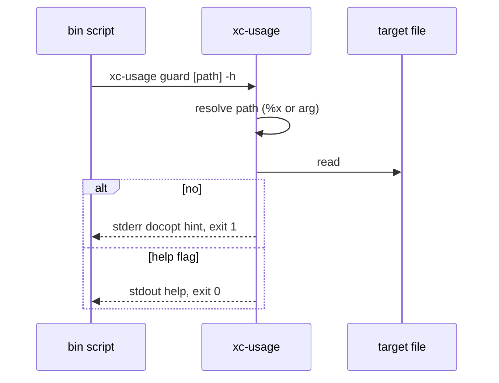

<!-- markdownlint-disable -->
# xc-usage — Design

## 1. OVERVIEW

`xc-usage` is the shared help utility for `config/bin` executables and (phase 2) Zsh autoload
functions via `show_usage`. It extracts
[docopt](http://docopt.org/)-style interface text from `##?` comment lines in a script file and
implements **`guard`**, which detects `-h` / `--help` on behalf of callers so bin scripts no
longer embed `grep | sed` for help.

**Single file:** `config/bin/xc-usage` — no `config/bin/lib/xc-usage/`.

**Strict prefix:** only `##?` is read. Legacy `#?` headers are rejected with an actionable error.

**Standalone:** `xc-usage` is a **self-contained** zsh script on `$PATH`. It is **inspired by**
the layout of the [mise task `usage` field](https://mise.jdx.dev/tasks/task-arguments.html)
and [docopt](http://docopt.org/), but it does **not** invoke mise, parse `mise.toml`, read
`#USAGE` / `#MISE` headers, set `usage_*` variables, or depend on the external `usage` CLI.
See [§12 Standalone vs mise](#12-standalone-vs-mise-inspired-conventions-only).

**Phases:**

| Phase | Scope                                                                       |
| ----- | --------------------------------------------------------------------------- |
| 1     | `config/bin` scripts adopt `xc-usage` + `##?`                               |
| 2     | `show_usage` + `config/zsh/etc/functions` inventory; `config/zsh/README.md` |

**Quick reference:** [§4 Command table](#41-invocation-table) · [§4.2 worked example](#42-end-to-end-example-xc-foo) ·
[§13 Out of scope](#13-out-of-scope)

---

## 2. FOLDER STRUCTURE

```tree
config/bin/
  ├── xc-usage                          ← executable; PATH symlink target
  ├── specs/xc-usage/
  │   ├── requirements.md
  │   ├── design.md
  │   └── tasks.md
  ├── tests/
  │   ├── xc-usage.spec.ts
  │   └── fixtures/xc-usage/
  │       ├── with-docopt.zsh           ← sample ##? Usage/Options
  │       └── legacy-hash.zsh           ← #? only (for error spec)
  └── mise.toml                         ← xc-usage:specs task

config/zsh/
  ├── README.md                         ← phase 2: ##? + show_usage + xc-usage conventions
  └── etc/functions/
      ├── show_usage                    ← phase 2: thin wrapper → xc-usage print
      └── …                             ← inventory §10.3
```

**Symlink:** `ln -sf ~/.config/bin/xc-usage ~/.local/bin/xc-usage`

---

## 3. ARCHITECTURE

```text
┌─────────────────┐     guard [script] "$@"      ┌──────────────┐
│ xc-fabric       │ ───────────────────────────► │              │
│ xc-skills       │     print [script]           │   xc-usage   │
│ xc-git          │ ───────────────────────────► │  (single     │
│ (flat file)     │   guard "${REPLY}" or       │   zsh file)  │
│                 │   "${0:a}" after resolve    │              │
└─────────────────┘                              └──────┬───────┘
                                                          │
                                                          ▼
                                                   grep '^##?'
                                                   sed strip prefix
                                                   stdout / stderr
```

### Sequence: `guard` with help



---

## 4. Command reference

All behavior is implemented in one file: `config/bin/xc-usage` (Zsh). No subcommands beyond
`guard`, `print`, and `validate`.

### 4.1 Invocation table

| Invocation                               | Subcommand / mode | Action                              | Stdout                             | Stderr                    | Exit           |
| ---------------------------------------- | ----------------- | ----------------------------------- | ---------------------------------- | ------------------------- | -------------- |
| `xc-usage`                               | (none)            | Print self `##?`                    | help text                          | —                         | **0**          |
| `xc-usage -h`                            | (none)            | Print self `##?`                    | help text                          | —                         | **0**          |
| `xc-usage --help`                        | (none)            | Print self `##?`                    | help text                          | —                         | **0**          |
| `xc-usage guard SCRIPT -h`               | `guard`           | Print **SCRIPT** `##?`              | help text                          | —                         | **0**          |
| `xc-usage guard SCRIPT --help`           | `guard`           | Print **SCRIPT** `##?`              | help text                          | —                         | **0**          |
| `xc-usage guard SCRIPT ARG…`             | `guard`           | Not help; caller continues          | (empty)                            | —                         | **2**          |
| `xc-usage guard` (no path, no `-h`)      | `guard`           | Not help (path = `xc-usage` itself) | (empty)                            | —                         | **2**          |
| `xc-usage guard MISSING -h`              | `guard`           | Error                               | —                                  | file / header error       | **1**          |
| `xc-usage guard LEGACY -h`               | `guard`           | `#?` only, no `##?`                 | —                                  | migrate hint + docopt URL | **1**          |
| `xc-usage print SCRIPT`                  | `print`           | Emit **all** `##?` lines (legacy)   | help text (+ optional footer §5.4) | —                         | **0**          |
| `xc-usage print SCRIPT --scope main`     | `print`           | Main docopt block only (§5.7)       | scoped help                        | —                         | **0**          |
| `xc-usage print SCRIPT --scope sub:run`  | `print`           | Sub block `run` only                | scoped help                        | —                         | **0** or **1** |
| `xc-usage list-subs SCRIPT`              | `list-subs`       | Subcommand names, one per line      | names                              | —                         | **0**          |
| `xc-usage preview SCRIPT --tool T`       | `preview`         | Stacked main + all subs (§5.8)      | launcher preview                   | —                         | **0**          |
| `xc-usage print SCRIPT --no-help-footer` | `print`           | Emit per `--scope` (no auto `-h`)   | help text                          | —                         | **0**          |
| `xc-usage print MISSING`                 | `print`           | Error                               | —                                  | file / header error       | **1**          |
| `xc-usage validate SCRIPT`               | `validate`        | Lint `##?` metadata                 | warnings (optional)                | errors on failure         | **0** or **1** |
| `xc-usage foo …`                         | (unknown)         | Self usage + error                  | self `##?`                         | `Unknown command`         | **1**          |

**Environment (optional):**

| Variable                    | Affects      | Effect                                                                |
| --------------------------- | ------------ | --------------------------------------------------------------------- |
| `XC_USAGE_NO_HELP_FOOTER=1` | `print` only | Same as `--no-help-footer` — do not append default `-h, --help` block |

**What `xc-usage` does not parse:** caller flags other than detecting `-h` / `--help` in `guard`;
remaining `ARG…` are ignored by `xc-usage` (the caller’s `zparseopts` handles them — see §13).

### 4.2 End-to-end example (`xc-foo`)

How help is **authored** (comments in the file) vs what the user **sees** when they run commands.
Same layout as `config/zsh/etc/functions/gen`, but as a **bin** script with `xc-usage guard` at the
top.

- **`#?`** — license / metadata only; **not** read by `xc-usage` (see [xc-portable-tools design §5](../xc-portable-tools/design.md#5-xc-usage-and--metadata)).
- **`##?`** — docopt help; `xc-usage` prints these lines (without the `##?` prefix).
- **Body** — `zparseopts` + real work; **not** `xc-usage`.

Zsh functions: same `##?` shape; use `show_usage` → `xc-usage print` instead of `guard` (§10.4).

---

#### Given: `config/bin/xc-foo`

```zsh
#!/usr/bin/env zsh
#? dots 0.1.0
#? License RIT (Robot Institute of Technology)
#? This is free software: you are free to change and redistribute it.
#? There is NO WARRANTY, to the extent permitted by law.
#? http://docopt.org · Command-line interface description language

##? Manage xc-foo
##?
##? Usage:
##?   xc-foo [options]
##?
##? Options:
##?   -h, --help                          Show this screen
##?   --c|-completions <toolname>         Generate completions for a command
##?                                       and save to ~/.config/zsh/opt/completions
##?
##? Examples:
##?   xc-foo -h                           Show help
##?   xc-foo --c fabric-ai                Generate ZSH completions for fabric-ai

emulate -L zsh

local _xc_u=2
command xc-usage guard "${0:a}" "$@"; _xc_u=$?
(( _xc_u == 0 )) && exit 0
(( _xc_u == 1 )) && exit 1

zparseopts -D -E h=help c:=completions || exit 1

if [[ -n $help ]]; then
  command xc-usage print "${0:a}"
  exit 0
fi

if [[ -n $completions ]]; then
  local toolname="${completions[2]:-}"
  [[ -z $toolname ]] && { command xc-usage print "${0:a}" >&2; exit 1 }
  local compdir="${HOME}/.config/zsh/opt/completions"
  print "Wrote completions for ${toolname} → ${compdir}/_${toolname:t}"
  exit 0
fi

command xc-usage print "${0:a}" >&2
exit 1
```

---

#### When: `xc-foo -h` (or `--help`)

`guard` extracts every `##?` line → stdout → script exits **0**. User sees:

```text
Manage xc-foo

Usage:
  xc-foo [options]

Options:
  -h, --help                          Show this screen
  --c|-completions <toolname>         Generate completions for a command
                                      and save to ~/.config/zsh/opt/completions

Examples:
  xc-foo -h                           Show help
  xc-foo --c fabric-ai                Generate ZSH completions for fabric-ai
```

Same text if you run `command xc-usage print ~/.config/bin/xc-foo` or
`command xc-usage guard ~/.config/bin/xc-foo -h`.

---

#### When: `xc-foo --c fabric-ai`

`guard` sees no `-h` / `--help` → exit **2** → script continues → `zparseopts` handles `--c` →
business logic runs. User sees **work output**, not the usage block:

```text
Wrote completions for fabric-ai → ~/.config/zsh/opt/completions/_fabric-ai
```

(exit **0**; exact path/message depends on implementation.)

---

#### When: `xc-foo` (no flags)

Nothing to do → script prints help on **stderr** (via `xc-usage print`) → exit **1**:

```text
Manage xc-foo

Usage:
  xc-foo [options]
…
```

---

#### Quick map

| You run                | What prints                         | Exit |
| ---------------------- | ----------------------------------- | ---- |
| `xc-foo -h`            | §4.2 help block (stdout)            | 0    |
| `xc-foo --c fabric-ai` | One line about completions (stdout) | 0    |
| `xc-foo`               | Help block (stderr)                 | 1    |

**Layers:** (1) `##?` + `xc-usage` = help text · (2) `zparseopts` = flags · (3) mise `usage` =
`mise run` tasks only. §11.1 is the empty template; this section is the filled-in example.

---

## 5. CLI contract

### 5.1 Top-level argv routing

Parsed **before** subcommands:

| argv           | Action                                         | Exit   |
| -------------- | ---------------------------------------------- | ------ |
| (empty)        | Print self `##?`                               | 0      |
| `-h`, `--help` | Print self `##?`                               | 0      |
| `guard …`      | §5.2                                           | varies |
| `print …`      | §5.4                                           | 0 or 1 |
| `validate …`   | §5.5                                           | 0 or 1 |
| anything else  | Print self usage + `Unknown command` on stderr | 1      |

Self-doc `##?` header (minimum) on `config/bin/xc-usage`:

```text
##? xc-usage - Print docopt help from ##? script headers
##?
##? Usage:
##?   xc-usage
##?   xc-usage -h | --help
##?   xc-usage guard [script] [args...]
##?   xc-usage print [script]
##?   xc-usage validate [script]
##?
##? Commands:
##?   guard     If args start with -h|--help, print script ##? and exit 0; else exit 2
##?   print     Always print script ##? and exit 0
##?   validate  Check script has a valid ##? docopt header; exit 0 or 1
##?
##? Options:
##?   -h, --help   Show this screen
```

### 5.2 Subcommand `guard`

**Invocation:**

```text
xc-usage guard [script-path] [caller-args...]
```

**Path resolution:**

1. If first argument after `guard` exists and is a regular file (`[[ -f "$1" ]]`), treat it as
   `script-path` and shift it off before inspecting caller args.
2. Else `script-path="${${(%):-%x}:a}"` — note: this resolves to **`xc-usage`’s path**, not the
   caller’s. Therefore **bin executables MUST NOT rely on omitted path** unless they use a
   wrapper pattern below.

**Caller pattern (required for top-level bin scripts):**

Bin scripts run `guard` as a subprocess; `%x` inside `xc-usage` points at `xc-usage`, not
`xc-fabric`. Callers MUST pass explicit path:

```zsh
# Top of xc-fabric (after ##? header):
local _xc_u=2
command xc-usage guard "${0:a}" "$@"; _xc_u=$?
(( _xc_u == 0 )) && exit 0
(( _xc_u == 1 )) && exit 1
```

For **flat dispatcher** `config/bin/xc-git` (after `_xc_git_resolve_self` sets `REPLY`):

```zsh
command xc-usage guard "${REPLY}" "$@"; local _xc_u=$?
(( _xc_u == 0 )) && exit 0
(( _xc_u == 1 )) && exit 1
```

Subcommand `-h` uses `command xc-usage print "${REPLY}" --scope sub:<name>` (not `_xc_git_subhelp`).

**Help detection:** after path resolution, if `${1:-}` is exactly `-h` or `--help`, extract and
print help, exit **0**. Otherwise exit **2** (no stdout help).

**Exit codes:**

| Code | Meaning                               |
| ---- | ------------------------------------- |
| 0    | Help printed                          |
| 1    | Error (missing file, no `##?`, I/O)   |
| 2    | Not a help request — caller continues |

### 5.4 Subcommand `print`

```text
xc-usage print [script-path]
```

Same path rules as §5.2. Always extracts `##?` to stdout, exit **0** on success, **1** on error.
Extra args after the optional script path are ignored.

**Optional footer (default on):** after emitting `##?` lines, if the combined text does not
match `-h` or `--help` (case-insensitive), append:

```text

Options:
  -h, --help    Show this screen.
```

Disable with env `XC_USAGE_NO_HELP_FOOTER=1` or flag `--no-help-footer` immediately after
`print` (implementation: `print [--no-help-footer] [script]`). Rationale: mirrors mise-generated
task help that always lists `-h, --help`; reduces author boilerplate without parsing KDL.

### 5.5 Subcommand `validate`

```text
xc-usage validate [script-path]
```

**Purpose:** lint `##?` metadata only — **no** CLI argument parsing (see §13), **no** mise integration.

**Checks (all required for exit 0):**

| Check               | Rule                                                                 |
| ------------------- | -------------------------------------------------------------------- |
| File exists         | readable regular file                                                |
| Has `##?`           | at least one line matching `^##?`                                    |
| Has Usage           | at least one `##?` line contains `Usage:` (case-sensitive substring) |
| Documents help flag | full `##?` text matches `-h` or `--help`                             |
| No legacy-only `#?` | if `^#?` matches exist and zero `^##?` → fail (same as print)        |

**Optional warnings** (stdout, still exit 0): missing `Options:` or `Examples:` sections.

**Exit codes:** 0 = valid; 1 = validation failed (details on stderr).

**Dependencies:** `zsh`, `grep`, `sed` only — same as `print`/`guard`.

### 5.6 Scoped help (`--scope`, `list-subs`, `preview`)

**Canonical authoring shape:** [§11.5 `xc-fabric` dispatcher template](#115-xc-fabric-dispatcher-template-canonical).
All `xc-*` bin tools (`xc-fabric`, `xc-skills`, `xc-git`, `xc-puts`, `xc-toast`) SHALL follow
[docopt](http://docopt.org/) section order: program summary line → blank → `Usage:` → `Options:` /
`Arguments:` / `Environment:` as needed → `Subcommands:` (dispatchers) → `Examples:`.

| Invocation                               | Action                                                                                                                         |
| ---------------------------------------- | ------------------------------------------------------------------------------------------------------------------------------ |
| `xc-usage list-subs SCRIPT`              | Print subcommand names (one per line): first token after indent on each `##? Subcommands:` / `##? Commands:` line              |
| `xc-usage print SCRIPT --scope main`     | Emit **main** block only (first `##? <tool> -` section; stop before `### Subcommand help blocks` or next `##? <tool> <sub> -`) |
| `xc-usage print SCRIPT --scope sub:NAME` | Emit block whose title line matches `^<tool> NAME -` (after stripping `##? `)                                                  |
| `xc-usage preview SCRIPT [--tool NAME]`  | Stacked stdout for `xc` launcher: main + each sub block, with section headers (§5.8)                                           |

**`--scope` flags:** exactly one of `main`, `sub:<name>`; unknown sub → exit **1** + stderr.
Omitting `--scope` on `print` keeps v1 behavior: emit **all** `##?` lines (backward compatible during migration).

**Who calls scoped print:**

| User runs               | Caller prints                                 |
| ----------------------- | --------------------------------------------- |
| `xc-fabric -h`          | `xc-usage print "$SCRIPT" --scope main`       |
| `xc-fabric run -h`      | `xc-usage print "$SCRIPT" --scope sub:run`    |
| `xc` fzf on `xc-fabric` | `xc-usage preview "$SCRIPT" --tool xc-fabric` |

Flat tools (`xc-puts`, `xc-toast`): one block only; `main` = full file; `list-subs` empty;
`preview` = same as `print --scope main`.

### 5.7 Block extraction algorithm

After `grep '^##?' | sed 's/^##? \{0,1\}//'`:

1. **Main block** — from line 0 until (exclusive):
   - line matching `^### Subcommand help blocks` (comment marker in source, not `##?`), or
   - line matching `^<tool> <word> -` where `<word>` is not `-` and not `(-h|--help)` (second title =
     subcommand block), or
   - EOF if no subs.
2. **Sub block `sub:NAME`** — from first line matching `^<tool> NAME -` until next sub title or EOF.
   Blank line inside block is kept (docopt readability).
3. **Tool name** — first word on first `##?` title line (`xc-fabric`, `xc-skills`, …); overridable
   with `--tool` on `preview` when the display name differs from the file basename (e.g. `--tool xc-git`).

Replace ad-hoc `_xc_git_subhelp` awk with `xc-usage print --scope sub:…`.

### 5.8 `preview` output shape (for `xc` launcher)

```text
<tool> - Main command:

<main scope body>

<tool> <sub> - Subcommand:

<sub scope body>
…
```

Each body MUST match what `print --scope main` / `print --scope sub:<sub>` would print alone.

### 5.9 Subcommand `-h` in bin scripts (dispatcher pattern)

Top-level `guard` MUST NOT print full file when subcommands use separate blocks. Pattern:

```bash
# After parsing subcommand:
case "$1" in
  -h|--help) command xc-usage print "$SCRIPT_PATH" --scope main; exit 0 ;;
  run) shift; [[ "${1:-}" == "-h" || "${1:-}" == "--help" ]] && { command xc-usage print "$SCRIPT_PATH" --scope sub:run; exit 0; }; … ;;
esac
```

Zsh (`xc-fabric`, `xc-git`): same with `"${0:a}"` / resolved package path.

---

## 6. Help extraction

**Algorithm `_xc_usage_emit(path)`:**

```zsh
if [[ ! -f "$path" ]]; then
  print -u2 "xc-usage: file not found: $path"
  return 1
fi
if ! grep -q '^##?' "$path" 2>/dev/null; then
  print -u2 "xc-usage: no ##? docopt header in: $path"
  print -u2 "Define help using ##? comments (Usage:/Options:) — see https://docopt.org/"
  return 1
fi
grep '^##?' "$path" | sed 's/^##? \{0,1\}//'
return 0
```

**Optional hint** when `#?` exists but `##?` does not:

```text
xc-usage: found #? lines but require ##? (migrate #? → ##? per config/bin/README.md)
```

---

## 7. Bin script adoption pattern

### Executable (e.g. `xc-fabric`)

1. Convert header `#?` → `##?`; add docopt sections.
2. Immediately after header (before heavy deps / network):

```zsh
local _xc_u=2
command xc-usage guard "${0:a}" "$@"; _xc_u=$?
(( _xc_u == 0 )) && exit 0
(( _xc_u == 1 )) && exit 1
```

3. Remove all `grep '^#?'` / `grep '^##?'` help branches used only for `-h`/`--help`.

### Flat dispatcher (`config/bin/xc-git`)

After `_xc_git_resolve_self`, `REPLY` is the flat script path. Top-level help:

```zsh
case "${1:-}" in
  -h|--help) command xc-usage print "${REPLY}" --scope main; exit 0 ;;
esac
```

Subcommand handlers: `-h` → `command xc-usage print "${REPLY}" --scope sub:<name>`; delete `_xc_git_subhelp`.

### Missing-args usage (unchanged in v1)

```zsh
if [[ -z "${required} ]]; then
  command xc-usage print "${0:a}" >&2
  exit 1
fi
```

---

## 8. Migration: `#?` → `##?`

| File / area                        | Action                                                                              |
| ---------------------------------- | ----------------------------------------------------------------------------------- |
| `config/bin/README.md` CONVENTIONS | Replace `#?` with `##?`; document `xc-usage guard`                                  |
| `xc-fabric`, `xc-skills`           | Header + guard adoption                                                             |
| `xc-git` (flat)                    | `##?` main + per-sub blocks; `guard` + scoped `print`                               |
| `specs/xc-git/*`                   | Update references from `#?` to `##?` where normative (follow-up doc edit in Task 5) |

Mechanical transform: `^#?` → `##?` at line start in header blocks only (not inside strings).

---

## 9. Testing

**File:** `config/bin/tests/xc-usage.spec.ts`

**Env:** `XC_USAGE={{ config_root }}/xc-usage`

**Scenarios (`usage_scenario` / `--scenario`):**

| ID                  | Covers                                                        |
| ------------------- | ------------------------------------------------------------- |
| `self_help`         | `xc-usage -h`, no args                                        |
| `guard_help`        | fixture `with-docopt.zsh` + `-h` → exit 0, Usage on stdout    |
| `guard_continue`    | fixture + no help flag → exit 2                               |
| `missing_docopt`    | fixture `legacy-hash.zsh` → exit 1, docopt URL in stderr      |
| `print`             | `print` on fixture → exit 0                                   |
| `validate_ok`       | `validate` on valid fixture → exit 0                          |
| `validate_fail`     | missing `-h` / legacy `#?` → exit 1                           |
| `footer`            | auto footer on `print`; `--no-help-footer` skips              |
| `metadata`          | `print --metadata` = `#?` only; default print omits `#?`      |
| `scope_main`        | **Task 1b** — `print --scope main` on `dispatcher-docopt.zsh` |
| `scope_sub`         | **Task 1b** — `print --scope sub:run`                         |
| `scope_sub_missing` | **Task 1b** — unknown sub → exit 1                            |
| `list_subs`         | **Task 1b** — `list-subs` one name per line                   |
| `preview_stacked`   | **Task 1b** — `preview` main + subs with section headers      |

**mise.toml:** `xc-usage:specs` choices MUST include all scenario IDs above once Task 1b lands.

---

## 10. Zsh functions and `show_usage`

### 10.1 Architecture

```text
Zsh session
  ├── autoload show_usage  (config/zsh/etc/functions/show_usage)
  │        └── command xc-usage print <resolved-source>
  ├── psc / pss / puts / gitx  → show_usage on -h
  ├── recase  → show_usage "$src" | show_usage recase
  └── dots git  → xc-git (bin); dots -h → xc-usage print dots file
```

**`xc-usage` on PATH** is required for `show_usage` to work (`~/.local/bin/xc-usage` symlink).

### 10.2 `show_usage` implementation (normative)

Replace body of `config/zsh/etc/functions/show_usage` with:

```zsh
show_usage() {
  local target="${1:-${funcstack[2]}}"
  local script=""

  if [[ -f "$target" ]]; then
    script="$target"
  else
    script="${functions_source[$target]:-}"
    if [[ -z "$script" ]] && (( $+functions[$target] )); then
      autoload -Uz +X "$target"
      script="${functions_source[$target]:-}"
    fi
    if [[ -z "$script" ]]; then
      for dir in ${fpath[@]}; do
        if [[ -f "$dir/$target" ]]; then
          script="$dir/$target"
          break
        fi
      done
    fi
  fi

  if [[ -z "$script" || ! -f "$script" ]]; then
    print -u2 "show_usage: could not resolve help for '$target'"
    return 1
  fi

  command xc-usage print "$script"
}
```

**Header** on `show_usage` file: `##?` docopt block describing args + note that implementation
delegates to `xc-usage print`.

**Bottom-of-file** `show_usage "$@"` when invoked as script: guard with `xc-usage` top-level
or keep only when file executed directly.

### 10.3 Migration inventory

| File         | Current help                   | Phase 2 action                                                     |
| ------------ | ------------------------------ | ------------------------------------------------------------------ |
| `show_usage` | inline `grep '^##?'`           | Delegate to `xc-usage print`; update `##?` header                  |
| `psc`        | `show_usage`                   | Verify `##?`; keep `show_usage` on `-h`                            |
| `pss`        | `show_usage`                   | Same                                                               |
| `puts`       | `show_usage`                   | Same                                                               |
| `gitx`       | `show_usage` (3 sites)         | Same; ensure `##?` block mentions xc-git                           |
| `recase`     | `show_usage "$src"` / `recase` | Same; relies on §10.2 file-path branch                             |
| `dots`       | `##?`; no global `-h`          | Add `-h`/`--help` → `show_usage` or `xc-usage print` at case entry |
| `keyring`    | `_keyring_show_usage` echo     | Expand top `##?`; replace helper with `show_usage keyring`         |
| `gen`        | `##?` + inline echo on `-h`    | On `-h`, call `show_usage gen`; remove duplicate echo help         |
| `osx`        | `##?` only                     | Add `-h`/`--help` → `show_usage osx` in dispatcher                 |
| `yw`         | `##?` only                     | Add help branch if missing                                         |
| `toast`      | `##?`                          | Audit; wire `show_usage` if `-h` exists                            |
| `zsys`       | `__usage` echo to stderr       | Convert to `##?` header + `show_usage zsys` on `-h`                |
| `barrel`     | `#?` license + `usage()` echo  | Convert help to `##?`; `-h` → `show_usage barrel`                  |

**Out of scope:** `config/zsh/opt/completions/*` (generated or third-party completion scripts).

### 10.4 Zsh function help pattern

After `zparseopts` (or `case` for `-h`):

```zsh
if (( ${+opts[-h]} )) || (( ${+opts[--help]} )); then
  show_usage "${0:t}"   # or: show_usage  # uses funcstack
  return 0
fi
```

Prefer **`show_usage`** (not bare `xc-usage guard`) inside functions — no `guard` unless the
function file is executed as a standalone script with `"$@"` passthrough.

---

## 11. Documentation deliverables

### 11.1 Canonical `##?` template (authors copy this)

Aligned with [docopt](http://docopt.org/) — Usage patterns, Options list, optional
`[options]` shortcut for shared flags ([docopt § Usage patterns](http://docopt.org/)).

**Flat tool** (`xc-puts`, `xc-toast`): single block — [§11.5 flat template](#115-xc-fabric-dispatcher-template-canonical).

**Dispatcher tool** (`xc-fabric`, `xc-skills`, `xc-git`): main block + one **sub block** per
subcommand — [§11.5 dispatcher template](#115-xc-fabric-dispatcher-template-canonical).

**Full walkthrough** (guard + zparseopts, no subcommands): [§4.2 End-to-end example (`xc-foo`)](#42-end-to-end-example-xc-foo).

### 11.5 `xc-fabric` dispatcher template (canonical)

**Reference implementation:** `config/bin/xc-fabric` lines 3–47 (main) + sub blocks after
`### Subcommand help blocks`.

#### Main block (`<tool> -h`)

MUST include: title, `Usage:` (all patterns including sub invocations), global `Options:`,
optional `Environment:`, `Subcommands:` summary lines, `Examples:` for top-level / mixed use.
MUST include `  <tool> -h | --help` in `Usage:`.

#### Sub block (`<tool> <sub> -h`)

Title line: `##? xc-fabric run - Run a named pattern…`

Body (docopt sections, same indentation style as main — no extra leading spaces on `Usage:`):

```text
##? Usage:
##?   xc-fabric [options] run <pattern> [url]
##?   xc-fabric run -h | --help
##?
##? Arguments:
##?   pattern    …
##?
##? Options:
##?   [options]  Global xc-fabric options (see xc-fabric -h)
##?
##? Examples:
##?   …
```

Sub-specific flags go under that sub’s `Options:`; shared flags stay in main `Options:` only.
Use docopt `[options]` in sub `Usage:` when the sub accepts global flags (see
[docopt `[options]` shortcut](http://docopt.org/)).

#### Marker before sub blocks (source file only)

```text
### Subcommand help blocks (parsed by xc-usage; not shown in help output) ###
```

#### Given / When (normative UX)

| When                        | Then stdout is                                                                   |
| --------------------------- | -------------------------------------------------------------------------------- |
| `xc-fabric -h`              | `print --scope main` → lines 3–47 shape (Options + Examples)                     |
| `xc-fabric run -h`          | `print --scope sub:run` → sub block only, same docopt style                      |
| `xc` highlights `xc-fabric` | `preview` → main + each of `run`, `ls`, `update`, `show`, `strategies`, `scrape` |

Apply the same table with `xc-skills` / `sync` / `collect`, `xc-git` / `branch-preview` / etc.

#### Flat template (`xc-puts`, `xc-toast`)

```text
##? xc-puts - Formats and prints a message
##?
##? Usage:
##?   xc-puts [options] <message>
##?   xc-puts -h | --help
##?
##? Arguments:
##?   message    …
##?
##? Options:
##?   …
##?
##? Examples:
##?   …
```

`print --scope main` = entire file; no sub blocks.

### 11.2 Three-layer help model (document prominently)

| Layer           | Mechanism                             | When                              |
| --------------- | ------------------------------------- | --------------------------------- |
| **Script help** | `##?` + `xc-usage` / `show_usage`     | `xc-fabric -h`, `gitx -h`, always |
| **CLI parsing** | `zparseopts` in the script            | real flags and positionals        |
| **Mise tasks**  | `usage = '''…'''` in `mise.toml` only | `mise run tool:specs --scenario`  |

**Rule:** never require `mise` to be installed for `xc-usage` or `show_usage` to work.

### 11.3 `config/zsh/README.md` (new)

Sections:

1. **Help conventions** — §11.1 template + docopt.org link
2. **Command reference** — link to design §4.1 table + §4.2 `xc-foo` example
3. **Standalone `xc-usage`** — not mise; PATH symlink only (§12)
4. **Out of scope** — no auto `zparseopts` from `##?` (§13)
5. **`show_usage`** — autoload, resolution order, examples
6. **`xc-usage`** — `guard` / `print` / `validate`, link to `config/bin/README.md`
7. **Authoring checklist** — `validate` before commit

### 11.4 Cross-links

- `config/bin/README.md` → “Zsh functions: see `config/zsh/README.md`”; §11.2 three-layer table
- `show_usage` file header → pointer to `config/zsh/README.md`; note “delegates to xc-usage (standalone)”

### 11.5 Spec cross-reference

Update `assets/specs/xc-git/design.md` §4 help note: `##?` + `xc-usage` (Task 9).

---

## 12. Standalone vs mise (inspired conventions only)

### 12.1 What xc-usage is not

| mise / [usage spec](https://mise.jdx.dev/tasks/task-arguments.html) feature | xc-usage                                                      |
| --------------------------------------------------------------------------- | ------------------------------------------------------------- |
| `usage = '''…'''` in `mise.toml`                                            | **Not read** — keep defining `xc-usage:specs` task separately |
| `#USAGE` / `#MISE` file-task headers                                        | **Not read** — bin scripts use `##?` only                     |
| `usage_*` env vars at task runtime                                          | **Not set** — use `zparseopts` in scripts                     |
| `{{ usage.* }}` Tera in task `run`                                          | **Not used**                                                  |
| `mise run <task> --help` code generation                                    | **Unrelated** — use `xc-usage guard` for script `-h`          |
| External `usage` CLI from jdx                                               | **Not invoked**                                               |

### 12.2 What xc-usage adopts (conventions only)

- Section layout: **Usage**, **Arguments**, **Options**, **Examples** in `##?` comments
- Always document **`-h | --help`** (enforced by `validate`; optional auto-footer on `print`)
- **validate** subcommand ≈ “help spec is complete” without implementing KDL parsing

### 12.3 Runtime dependencies

**Required:** `zsh`, `grep`, `sed`, executable bit on `config/bin/xc-usage`.

**Not required:** `mise`, `bun` (except when *developers* run tests), `gum`, `fzf`, network.

**CI note:** `mise run xc-usage:specs` is a **developer convenience** that shells out to Bun; the
`xc-usage` binary under test must pass when invoked as `zsh /path/to/xc-usage` with mise absent
from `PATH`.

### 12.4 Naming

- Tool name **`xc-usage`** means “extract **usage** text from scripts” in this repo — not “the
  mise usage parser.”
- In docs, refer to mise’s feature as **“mise task `usage` field”** to avoid ambiguity.

---

## 13. Out of scope

The following are **explicitly not** part of `xc-usage` (v1 or planned coupling). Authors
implement them in each script or function; `xc-usage` only reads `##?` text for display and lint.

### 13.1 Docopt-driven `zparseopts` (auto-parse `##?` → flags)

**Not implemented.** [docopt](http://docopt.org/) parses the full usage grammar (positionals,
optional/required groups, commands, defaults) and matches `argv`. Zsh `zparseopts` only handles
**option flags** in the **current shell**; it does not read `Usage:` lines or `<placeholders>`.

| Limitation  | Why it blocks auto-parsing                                                           |
| ----------- | ------------------------------------------------------------------------------------ |
| Subprocess  | `command xc-usage guard …` cannot set the caller’s `opts` array or mutate `$@`       |
| Grammar gap | `##?` lines like `--c\|-completions <toolname>` do not map 1:1 to `zparseopts` specs |
| Positionals | `Usage: xc-foo <name>` is not expressible as `zparseopts` alone                      |
| Full docopt | Would require a docopt implementation in zsh — a separate project                    |

**Authoring rule:** keep **Layer 1** (`##?` + `xc-usage`) and **Layer 2** (`zparseopts` in the
script) in sync by convention; use `validate` for header completeness, not flag parity.

**Possible future (optional, not scheduled):** `validate` could **warn** when an `Options:` line
mentions a flag with no obvious `-x` / `--long` in the same file — heuristic only, still no
auto-generated `zparseopts`.

### 13.2 Other non-goals

| Item                                                  | Where instead                      |
| ----------------------------------------------------- | ---------------------------------- |
| Parse caller argv (beyond `-h` / `--help` in `guard`) | Caller `zparseopts` / `case`       |
| Mise task `usage` / KDL / `#USAGE`                    | `mise.toml` + `mise run`           |
| External `usage` CLI (jdx)                            | Not used                           |
| Generate completions from `##?`                       | `gen`, completion scripts          |
| `config/zsh/opt/completions/*`                        | Third-party / generated (§10.3)    |
| Infer full docopt from script / minimal `##?` only    | Authors maintain full `##?` (§4.2) |

---

## 14. Decision log

### Decision: `guard` exit code 2 for “not help”

**Context:** Callers need to distinguish error vs continue.

**Decision:** Use 0 / 1 / 2 as specified in §5.2.

**Rationale:** Matches common CLI helper patterns; testable from Bun without parsing output.

### Decision: Strict `##?` only

**Context:** Bin README used `#?`; Zsh uses `##?`.

**Decision:** Reject files with only `#?`; error cites docopt.org.

**Rationale:** One prefix across bin + future function unification; forces explicit migration.

### Decision: Explicit `${0:a}` for top-level bin scripts

**Context:** `guard` without path cannot infer caller when invoked as subprocess.

**Decision:** Require `command xc-usage guard "${0:a}" "$@"` in executables.

**Rationale:** Correct path without Zsh `%x` parent stack hacks.

### Decision: Standalone tool (no mise coupling)

**Context:** `xc-usage` name overlaps with mise “usage” field.

**Decision:** Zero runtime dependency on mise; inspiration limited to docopt section layout.

**Rationale:** Bin and Zsh tools must work on any machine with dotfiles symlinks, not only dev
environments with mise activated.

### Decision: `validate` + optional help footer

**Context:** mise always documents `-h, --help` in generated task help.

**Decision:** Add `validate` subcommand; `print` appends standard help option line when missing
(default on, overridable).

**Rationale:** Simplifies authors without porting KDL or `usage_*` machinery.

### Decision: No docopt-driven `zparseopts` in xc-usage

**Context:** Authors asked whether `##?` could drive `zparseopts` automatically.

**Decision:** Out of scope per §13.1; three-layer model (§11.2) keeps parsing in each script.

**Rationale:** Subprocess boundary, incomplete mapping, and full docopt ≠ `zparseopts` subset.

### Decision: No inferring docopt from code or minimal `##?`

**Context:** Whether `xc-usage` could “fill in” Usage/Options from `zparseopts` or a one-line
description when `##?` is missing or sparse.

**Decision:** Out of scope. Help output is exactly what authors put in `##?` (+ optional
`print` footer if `-h` undocumented). No static analysis of scripts for v1.

**Rationale:** Heuristic inference drifts from real behavior; full `##?` is the single source of
truth (see §4.2 Given/When example).

### Decision: `xc-fabric` docopt blocks + scoped `print` (Req-12)

**Context:** Users want `xc-fabric -h` to show the full dispatcher (Options + Examples) and
`xc-fabric run -h` a focused sub help; `xc` launcher shows all sections at once.

**Decision:** Author multiple `##?` blocks per file (main + `##? xc-fabric run - …` subs);
`xc-usage print --scope main|sub:NAME` and `preview` for launcher. Same pattern for
`xc-skills`, `xc-git`; flat tools use one block.

**Rationale:** Matches [docopt](http://docopt.org/); one parser in `xc-usage`; preview =
concatenation of scopes, not duplicate strings in `xc`.
