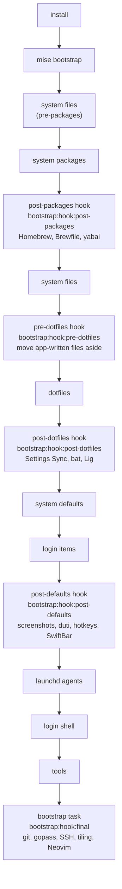

# Bootstrap

`install` prepares mise and clones this repo; `mise bootstrap` applies everything else. This page is the single
source for what that run does, how the pieces fit, and how to run or debug a single step.

## Overview

`install` installs `git` (Linux) and the pinned mise, clones the repo into `~/.local/share/dots`, restores the
encrypted secrets, links `~/.config/mise`, records the profile in `config/mise/miserc.local.toml`, and hands over to
`mise bootstrap -E <profile>`.

mise reads `~/.config/mise` (linked to `config/mise/` in this repo) and runs its phases in this order. Declarative
parts (directories, files, packages, dotfiles, settings) come from the TOML files; the hooks hand over to one phase
task each, and that task runs its steps in order.



The hook tasks and the global task live in [`config/mise/conf.d/bootstrap.toml`](../config/mise/conf.d/bootstrap.toml)
and [`.mise/tasks/bootstrap/phases.toml`](../.mise/tasks/bootstrap/phases.toml). The steps live under
[`.mise/tasks/bootstrap/`](../.mise/tasks/bootstrap).

## Rationale

- **Declarative first.** Directories, system files, packages, links and macOS preferences are declared in TOML under
  `config/mise/`; `mise bootstrap` diffs and applies them. Shell only does what the schema cannot: cloning, building,
  talking to Keychain, loading a scripting addition.
- **Thin hooks.** A `bootstrap.hooks.<phase>` hook can only run shell. Each one is a hand-over,
  `mise run -C "$HOME/.local/share/dots" bootstrap:hook:<phase>`, so the real work is visible in `mise tasks ls` and
  can be run alone. There is exactly one hook per phase: mise runs every conf.d file's hook, so two files declaring
  `post-defaults` would run two hooks.
- **File tasks, not TOML strings.** Every step is an executable bash file with a `#MISE description` header. That
  gives linting (shellcheck, shfmt), a per-step spec, `mise run bootstrap:<area>:<step>`, and the task features
  (`skip_if`, `sources`, `raw`). The shared preamble (paths, profile, guards, `warn`, logging) is
  [`.mise/tasks/bootstrap/_lib.sh`](../.mise/tasks/bootstrap/_lib.sh).
- **`skip_if` over `outputs`.** Most bootstrap state is not a file mise can stat: a Keychain item, a running yabai,
  brew's installed set. A cheap idempotent check is the honest up-to-date test; `sources`/`outputs` are used only
  where a real file is the state (JankyBorders' `.rev`, Neovim's `lazy-lock.json`).
- **Soft failures keep their meaning.** A step that only warns (a failed optional package, an unavailable theme
  cache) calls `warn` and exits 0, so later steps still run. `DOTS_STRICT` or `CI` turns the same warning into exit 1.
  Hard failures (the Brewfile's core group, a missing prerequisite) stop the phase.

Decisions live in [`docs/adr/`](adr/README.md); this page records the mechanics.

## Profiles

The profile is a comma list. `mise run setup <profile>` records it in `config/mise/miserc.local.toml` and runs the
bootstrap with it; `mise bootstrap -E <profile>` overrides it for one run. The steps that care use `has_profile`,
which matches a whole name (`dev` does not match `devops`).

| Profile | What runs |
| --- | --- |
| `container` | Git filters, packages, links, the login shell. No desktop steps, no hooks beyond the hand-overs. |
| `desktop` | The above, plus git hooks, gopass, SSH, tiling, models and Neovim. |
| `desktop,dev` | The above, plus the Python 3.13 tools and the agent-skills restore. |

```sh
mise run setup dev       # desktop + dev
mise run setup desktop   # back to desktop (uninstalls nothing)
```

## Steps

Each phase task runs its steps in this order. The table tells you what a step does, when it skips, and whether it can
ask for input. `desktop` means the desktop profile only; `macOS` is checked at the step.

| Task | Phase | Platform / profile | What it does | Up-to-date check | May prompt |
| --- | --- | --- | --- | --- | --- |
| `bootstrap:hook:post-packages` | post-packages | all | Runs the four Homebrew and yabai steps | — | — |
| `bootstrap:brew:install` | post-packages | all, when brew is missing | Installs Homebrew | `skip_if`: any brew on PATH or in a prefix | yes (sudo) |
| `bootstrap:brew:config-link` | post-packages | all | Links `~/.config/homebrew` into the repo for brew's trust store | `skip_if`: the path exists | no |
| `bootstrap:brew:bundle` | post-packages | all | Installs the Brewfile: the core group is fatal, the rest warns and records `brew-bundle.failed` | — (brew is idempotent) | no |
| `bootstrap:yabai:scripting-addition` | post-packages | macOS | `yb sa`: sudoers rule and boot argument | — | no |
| `bootstrap:hook:pre-dotfiles` | pre-dotfiles | all | Runs the move-aside step | — | — |
| `bootstrap:dotfiles:move-aside` | pre-dotfiles | macOS | Moves real VS Code settings/keybindings/snippets and `~/.config/karabiner` aside, dated | — | no |
| `bootstrap:hook:post-dotfiles` | post-dotfiles | all | Runs the three post-dotfiles steps | — | — |
| `bootstrap:vscode:settings-sync` | post-dotfiles | macOS | Turns Settings Sync off for settings, keybindings and snippets | — | no |
| `bootstrap:bat:cache` | post-dotfiles | all with bat | Builds bat's theme cache | — | no |
| `bootstrap:lig:zsh` | post-dotfiles | all with Lig | `mise run zsh:lig` | — | no |
| `bootstrap:hook:post-defaults` | post-defaults | all | Runs the two macOS steps | — | — |
| `bootstrap:macos:activate` | post-defaults | macOS | Screenshots folder, `duti`, the Spotlight hotkey, restart Dock/Finder/SystemUIServer | — (runs every time, never fails) | no |
| `bootstrap:macos:swiftbar` | post-defaults | macOS | Points SwiftBar at `~/.config/swiftbar/plugins` | — | no |
| `bootstrap:hook:final` | `bootstrap` task | all | Runs the remaining steps in order | — | — |
| `bootstrap:git:filters` | final (first) | all | `mise run setup:git:filters` | — | no |
| `bootstrap:zsh:warm-caches` | final | all | `zsh -ic 'exit'` to build the shell caches | — | no |
| `bootstrap:git:hooks` | final | desktop | `mise run setup:hooks` | — | no |
| `bootstrap:dev:python-tools` | final | dev | `uv tool install` graphifyy and code-review-graph with Python 3.13 | — (`uv tool list`) | no |
| `bootstrap:gopass:store` | final | desktop | Clones `pass-store` once the age identity is there | `skip_if`: `password-store/.git` exists | no |
| `bootstrap:gopass:keyring` | final | desktop | Warns when the keyring still uses a passphrase or an identity file is missing | — | no |
| `bootstrap:gopass:pass-link` | final | desktop | Links `~/.local/bin/pass` to gopass, never replacing a real `pass` | — (idempotent) | no |
| `bootstrap:ssh:keychain` | final | desktop, macOS | Loads the GitHub signing key from Keychain, or stores it there | — | yes (SSH passphrase, once) |
| `bootstrap:tiling:checks` | final | desktop, macOS | Clones the kb Raycast extension and prints SIP/yabai hints | — | no |
| `bootstrap:borders:build` | final | desktop, macOS | Builds JankyBorders at the pinned commit and restarts its service | `skip_if`: `.rev` matches the pin | no |
| `bootstrap:omlx:models` | final | desktop, macOS with oMLX | Downloads only the missing models | per-model `config.json` | no |
| `bootstrap:skills:restore` | final | dev | Restores the agent skills in the background | — | no |
| `bootstrap:nvim:providers` | final | desktop | Installs the npm and gem Neovim providers when missing | per-provider check | no |
| `bootstrap:nvim:plugins` | final | desktop | `nvim --headless "+Lazy! restore"` | `sources`: `config/nvim/lazy-lock.json` | no |
| `bootstrap:brew:remind` | final (last) | all | Repeats the `brew-bundle.failed` warning | — | no |

Tiling is covered by `bootstrap:yabai:scripting-addition`, `bootstrap:borders:build` and the `yabai.toml` declarations
(packages, links, the fn key, the SwiftBar login item); [`docs/TILING.md`](TILING.md) has the manual steps that follow.

## Recipes

```sh
# Preview without changing anything
mise bootstrap status             # what differs from the config
mise bootstrap status --missing   # exit 1 when anything differs
mise bootstrap plan               # what applying would change
mise bootstrap --dry-run          # the full run, including every hook

# Run one step, or re-run it
mise run bootstrap:brew:bundle
mise run --force bootstrap:bat:cache
mise run --dry-run bootstrap:hook:final   # the final phase in order

# Finish part of a bootstrap from a terminal (interactive steps skipped earlier)
mise bootstrap --only files,macos-defaults,macos-launchd-agents,task
mise bootstrap --skip dotfiles

# Checks
mise run mise:diagnostics         # LSP diagnostics over every mise config file
mise doctor project               # project checks, including the mise version and diagnostics
mise run mise:version --check     # every MISE_VERSION pin matches this Mac
mise run mise:version --sync      # rewrite the pins to this Mac's mise

# macOS preferences (details in docs/MACOS.md)
mise bootstrap macos defaults apply --dry-run
mise bootstrap macos defaults apply
mise bootstrap macos defaults status --missing

# Secrets history
mise bootstrap --adopt            # restore the encrypted dots-history repo
```

**Add a step.** Create `.mise/tasks/bootstrap/<area>/<step>.sh` with `#!/usr/bin/env bash`, a
`#MISE description="…"` header, `. "${BASH_SOURCE%/*}/../_lib.sh"`, `set -euo pipefail`, the profile/platform guard
(`has_profile desktop || exit 0`, `is_macos || exit 0`), and `bootstrap_init`. Add it to the phase's `run` list in
`phases.toml`, in the position it must run. Add a spec under `test/integration/bootstrap/` that calls
`runStep("<area>/<step>.sh", env)`; run `mise tasks ls | grep bootstrap:` to confirm it is listed.

## Gotchas

- **The new config keys need mise ≥ 2026.11.8.** `bootstrap.settings.macos.*` does not exist in older schemas; the
  pins in `install` and both Dockerfiles are checked by `mise run mise:version --check`.
- **Only the LSP reports deprecated or unknown keys.** `mise doctor` and `bootstrap --dry-run` are silent about
  them; `mise run mise:diagnostics` (also in `hk check`) is the command that does.
- **The profile is read from the parent process.** `mise bootstrap -E desktop,dev` puts the profile in `MISE_ENV`; a
  hook resolves it with `dots_profile` and passes `DOTS_PROFILE` down, because inside `mise run` the parent is no
  longer `mise bootstrap`. Running a phase task by hand falls back to `miserc.local.toml`, then `desktop`.
- **Early phases run before the dotfiles and most tools.** `post-packages` runs before `~/.local/bin` is linked and
  before Bun exists, so its steps are plain bash with no task `tools`.
- **Hooks only run shell.** They cannot call a task type or declare `skip_if`; the hand-over is the only hook body.
- **Hooks and the `bootstrap` task run on every bootstrap.** mise does not diff them; only the declarative parts are
  diffed, and each step does its own up-to-date check.
- **One hook per phase.** mise runs every conf.d file's hook for a phase, so all hand-overs live in
  `config/mise/conf.d/bootstrap.toml`. Adding a hook to `yabai.toml` or `macos.toml` would run the phase twice.
- **A failing step stops the phase.** Steps that may fail harmlessly call `warn` (exit 0); `DOTS_STRICT`/`CI` makes
  those failures fatal, and mise stops the run there.
- **`sources`/`outputs` resolve from the task directory** and must name real files; system state that is not a file
  uses `skip_if`.

## Troubleshooting

- **A package failed.** The core group stops the bootstrap; any other Brewfile entry only warns, completes the run,
  and writes the names to `~/.local/state/dots/brew-bundle.failed` (output in `brew-bundle.log` beside it).
  `bootstrap:brew:remind` repeats the warning at the end. Fix the entry (an architecture gate such as
  `if OS.linux? && Hardware::CPU.intel?`, or remove it), then `brew bundle install`.
- **The run asked for nothing.** Interactive steps (`bootstrap:brew:install`, `bootstrap:ssh:keychain`) are skipped
  with a message when there is no terminal. Finish them with
  `mise bootstrap --only files,macos-defaults,macos-launchd-agents,task` from a terminal.
- **The SSH key never reaches the agent.** Check `ssh-add -l`; the passphrase is stored once with
  `ssh-add --apple-use-keychain ~/.ssh/id_ed25519_github`. The `dev.mise.ssh-add` LaunchAgent loads it at login.
- **SIP is fully on.** yabai's scripting addition needs it partly off: in Recovery,
  `csrutil enable --without fs --without debug --without nvram`, reboot, run `mise bootstrap` again, reboot. See
  [`docs/TILING.md`](TILING.md).
- **Stale shell or theme caches.** `mise run bootstrap:zsh:warm-caches` and `mise run zsh:lig` rebuild them;
  `mise run bootstrap:bat:cache` rebuilds bat's theme cache.
- **Find the log.** Every step appends to `~/.local/state/dots/logs/latest.log` (the ten newest runs are kept).
  `mise run bootstrap:hook:final --dry-run` shows the order without running anything.
