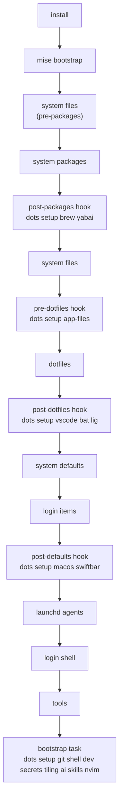

# Bootstrap

`install` prepares mise and clones this repo; `mise bootstrap` applies everything else. Day-to-day setup, backup, and
profile changes go through one global front door: `mise run dots`. This page is the single source for what that run
does, how the pieces fit, and how to run or debug a single step.

## Overview

`install` installs `git` (Linux) and the pinned mise, clones the repo into `~/.local/share/dots`, restores the
encrypted secrets, links `~/.config/mise`, records the profile in `config/mise/miserc.local.toml`, and hands over to
`mise bootstrap -E <profile>`.

mise reads `~/.config/mise` (linked to `config/mise/` in this repo). Each `config/mise/conf.d/` file has one job:

| File | Job |
| --- | --- |
| `vars.yaml` | Hard-coded bootstrap values (`dots_dir`), loaded into `{{ vars.* }}` without exporting |
| `bootstrap.toml` | Machine setup: directories, system files, login shell, hooks, the `bootstrap` task, and `vars.yaml` loading |
| `dotfiles.toml` | Symlinks (`[dotfile_groups.config]` for `~/.config/<name>`, plus plain `[dotfiles]` entries outside it) |
| `macos.toml` | macOS preferences, Touch ID sudo, login items, and LaunchAgents (including yabai and borders) |
| `system.toml` | Linux apt packages needed before Homebrew |
| `tasks.toml` | The `mise run dots` front door (`setup`, `backup`, `profile`) and nothing else |

Declarative parts (directories, files, packages, dotfiles, settings) come from those TOML files; each hook and the
global `bootstrap` task call `mise run dots setup` with the parts of their phase:



The front door lives in [`config/mise/conf.d/tasks.toml`](../config/mise/conf.d/tasks.toml); hooks and `[tasks.bootstrap]`
live in [`config/mise/conf.d/bootstrap.toml`](../config/mise/conf.d/bootstrap.toml). The hidden part tasks
(`dots:setup:<part>`) live in [`.mise/tasks/bootstrap/parts.toml`](../.mise/tasks/bootstrap/parts.toml), and the hidden
step file tasks live under [`.mise/tasks/bootstrap/`](../.mise/tasks/bootstrap).

## Rationale

- **One front door.** `mise run dots --help` lists only what dots can do: `dots setup`, `dots backup`, and
  `dots profile`. Their parts, actions and profiles are positional arguments with a `complete` list, so Tab shows
  each with its help from the first keystroke (`choices` would show bare names, and flags only after `--`); the
  task's script (for backup actions, `backup.ts`) rejects an unknown name with exit 2. Every part task
  (`dots:setup:<part>`) and step task (`bootstrap:<area>:<step>`) is hidden (`hide = true`), so `mise tasks ls`
  stays clean while `mise tasks ls --hidden` lists every step.
- **Declarative first.** Directories, system files, packages, links and macOS preferences are declared in TOML under
  `config/mise/`; `mise bootstrap` diffs and applies them. Shell only does what the schema cannot: cloning, building,
  talking to Keychain, loading a scripting addition.
- **Thin hooks that name what they set up.** Each `bootstrap.hooks.<phase>` hook is
  `run = "{{ vars.dots_setup }} --no-remind <part>..."`, which forwards the selected profiles from `mise_env` as
  `--profile <name>` flags and runs `mise run dots setup` (skipping the Brewfile reminder until `[tasks.bootstrap]`
  runs last). There is exactly one hook per phase, all in `config/mise/conf.d/bootstrap.toml`.
- **File tasks, not TOML strings.** Every step is an executable bash file with `#MISE hide=true`,
  `#MISE extends="bootstrap_step"` (shared `--profile` flag backed by `DOTS_PROFILE`), and `#MISE description`. That
  gives linting (shellcheck, shfmt), a per-step spec, direct `mise run bootstrap:<area>:<step>`, and the task features
  (`skip_if`, `sources`, `raw`). The shared preamble (paths, profile validation, guards, `warn`, logging) is
  [`.mise/tasks/bootstrap/_lib.sh`](../.mise/tasks/bootstrap/_lib.sh).
- **`skip_if` over `outputs`.** Most bootstrap state is not a file mise can stat: a Keychain item, a running yabai,
  brew's installed set. A cheap idempotent check is the honest up-to-date test; `sources`/`outputs` are used only
  where a real file is the state (JankyBorders' `.rev`, Neovim's `lazy-lock.json`).
- **Soft failures keep their meaning.** A step that only warns (a failed optional package, an unavailable theme
  cache) calls `warn` and exits 0, so later steps still run. `DOTS_STRICT` or `CI` turns the same warning into exit 1.
  Hard failures (the Brewfile's core group, a missing prerequisite) stop the phase.

Decisions live in [`docs/adr/`](adr/README.md); this page records the mechanics.

## Profiles

The profile is a validated `--profile` flag (`desktop`, `dev`, `container`). `dots setup` accepts repeatable
`--profile` flags or a comma list (including `DOTS_PROFILE=desktop,dev`), exits 2 on unknown names, and when neither
`--profile` nor `DOTS_PROFILE` is given uses this run's filtered `mise_env` (`miserc.local.toml` / `-E`), else
`desktop`. `mise run dots profile <profile>` runs `mise bootstrap -E <list> --save-env --yes`, which records it in
`config/mise/miserc.local.toml` (even when the run fails); `mise bootstrap -E <profile>` alone overrides it for one
run. `install` writes that file itself: its bootstrap runs with a temporary `~/.config/mise`, where `--save-env` would
save it. Steps check `has_profile`, which validates `usage_profile` and matches whole names (`dev` does not match
`devops`).

| Profile | What runs |
| --- | --- |
| `container` | Git filters, packages, links, the login shell. No desktop steps, no hooks beyond the hand-overs. |
| `desktop` | The above, plus git hooks, gopass, SSH, tiling, models and Neovim. |
| `desktop,dev` | The above, plus the Python 3.13 tools and the agent-skills restore. |

```sh
mise run dots profile dev       # desktop + dev
mise run dots profile desktop   # back to desktop (uninstalls nothing)
```

## Steps

`mise run dots setup [part]...` runs the parts given (or all 16 when none is given) in this fixed order, whatever
order you type them in; `mise run dots setup` then Tab lists each part with its help. It ends with
`dots:setup:remind` (`bootstrap:brew:remind`) once per manual run (and once at the end of `mise bootstrap`, via
`[tasks.bootstrap]`; the four earlier hooks pass `--no-remind`). The table tells you each part, what each step
does, when it skips, and whether it can ask for input.

| Part | Task | Phase | Platform / profile | What it does | Up-to-date check | May prompt |
| --- | --- | --- | --- | --- | --- | --- |
| `brew` | `bootstrap:brew:install` | post-packages | all, when brew is missing | Installs Homebrew | `skip_if`: any brew on PATH or in a prefix | yes (sudo) |
| `brew` | `bootstrap:brew:config-link` | post-packages | all | Links `~/.config/homebrew` into the repo for brew's trust store | `skip_if`: the path exists | no |
| `brew` | `bootstrap:brew:bundle` | post-packages | all | Installs the Brewfile: the core group is fatal, the rest warns and records `brew-bundle.failed` | — (brew is idempotent) | no |
| `yabai` | `bootstrap:yabai:scripting-addition` | post-packages | macOS | `yb sa`: sudoers rule and boot argument | — | no |
| `app-files` | `bootstrap:dotfiles:move-aside` | pre-dotfiles | macOS | Moves real VS Code settings/keybindings/snippets and `~/.config/karabiner` aside, dated | — | no |
| `vscode` | `bootstrap:vscode:settings-sync` | post-dotfiles | macOS | Turns Settings Sync off for settings, keybindings and snippets | — | no |
| `bat` | `bootstrap:bat:cache` | post-dotfiles | all with bat | Builds bat's theme cache | — | no |
| `lig` | `bootstrap:lig:zsh` | post-dotfiles | all with Lig | `mise run zsh:lig` | — | no |
| `macos` | `bootstrap:macos:activate` | post-defaults | macOS | Screenshots folder, `duti`, the Spotlight hotkey, restart Dock/Finder/SystemUIServer | — (runs every time, never fails) | no |
| `swiftbar` | `bootstrap:macos:swiftbar` | post-defaults | macOS | Points SwiftBar at `~/.config/swiftbar/plugins` | — | no |
| `git` | `bootstrap:git:filters` | `bootstrap` task | all | `mise run setup:git:filters` | — | no |
| `git` | `bootstrap:git:home-config` | `bootstrap` task | all | Warns when a real `~/.gitconfig` overrides the dots git config | — | no |
| `git` | `bootstrap:git:hooks` | `bootstrap` task | desktop | `mise run setup:hooks` | — | no |
| `shell` | `bootstrap:zsh:warm-caches` | `bootstrap` task | all | `zsh -ic 'exit'` to build the shell caches | — | no |
| `dev` | `bootstrap:dev:python-tools` | `bootstrap` task | dev | `uv tool install` graphifyy and code-review-graph with Python 3.13 | — (`uv tool list`) | no |
| `secrets` | `bootstrap:gopass:store` | `bootstrap` task | desktop | Clones `pass-store` once the age identity is there | `skip_if`: `password-store/.git` exists | no |
| `secrets` | `bootstrap:gopass:keyring` | `bootstrap` task | desktop | Warns when the keyring still uses a passphrase or an identity file is missing | — | no |
| `secrets` | `bootstrap:gopass:pass-link` | `bootstrap` task | desktop | Links `~/.local/bin/pass` to gopass, never replacing a real `pass` | — (idempotent) | no |
| `secrets` | `bootstrap:ssh:keychain` | `bootstrap` task | desktop, macOS | Loads the GitHub signing key from Keychain, or stores it there | — | yes (SSH passphrase, once) |
| `tiling` | `bootstrap:tiling:checks` | `bootstrap` task | desktop, macOS | Clones the kb Raycast extension and prints SIP/yabai hints | — | no |
| `tiling` | `bootstrap:borders:build` | `bootstrap` task | desktop, macOS | Builds JankyBorders at the pinned commit and restarts its service | `skip_if`: `.rev` matches the pin | no |
| `ai` | `bootstrap:omlx:models` | `bootstrap` task | desktop, macOS with oMLX | Downloads only the missing models | per-model `config.json` | no |
| `skills` | `bootstrap:skills:restore` | `bootstrap` task | dev | Restores the agent skills in the background | — | no |
| `nvim` | `bootstrap:nvim:providers` | `bootstrap` task | desktop | Installs the npm and gem Neovim providers when missing | per-provider check | no |
| `nvim` | `bootstrap:nvim:plugins` | `bootstrap` task | desktop | `nvim --headless "+Lazy! restore"` | `sources`: `config/nvim/lazy-lock.json` | no |
| _(always last)_ | `bootstrap:brew:remind` | `bootstrap` task | all | Repeats the `brew-bundle.failed` warning | — | no |

Tiling is covered by `bootstrap:yabai:scripting-addition`, `bootstrap:borders:build`, and the LaunchAgents in
`config/mise/conf.d/macos.toml` (packages, links, the fn key, the SwiftBar login item); [`docs/TILING.md`](TILING.md)
has the manual steps that follow.

## Recipes

```sh
# Front door help
mise run dots --help
mise run dots setup --help
mise run dots backup --help

# Run one or more setup parts (always in fixed order, followed by brew:remind)
mise run dots setup brew yabai
mise run dots setup git shell --profile desktop --profile dev
mise run dots setup --dry-run

# Run a single hidden step by hand (inherits --profile default desktop, or DOTS_PROFILE)
mise run bootstrap:brew:bundle --profile desktop,dev
mise run --force bootstrap:bat:cache
mise tasks ls --hidden | grep bootstrap:

# Switch profile (desktop vs desktop + dev tools)
mise run dots profile dev
mise run dots profile desktop

# Backups and reinstall audit (details in docs/REINSTALL.md)
mise run dots backup backup
mise run dots backup restore --include Work --dry-run
mise run dots backup audit --stdout

# Preview without changing anything
mise bootstrap status             # what differs from the config
mise bootstrap status --missing   # exit 1 when anything differs
mise bootstrap plan               # what applying would change
mise bootstrap --dry-run          # the full run, including every hook

# Finish part of a bootstrap from a terminal (interactive steps skipped earlier)
mise bootstrap --only files,macos-defaults,macos-launchd-agents,task
mise bootstrap --skip dotfiles

# Checks
mise run mise:diagnostics         # LSP diagnostics over every mise config file
mise doctor project               # project checks, including the mise version and diagnostics
mise run mise:version --check     # every MISE_VERSION pin matches this Mac
mise run mise:version --sync      # rewrite the pins to this Mac's mise

# macOS preferences (details in docs/MACOS.md)
mise bootstrap macos defaults apply --dry-run
mise bootstrap macos defaults apply
mise bootstrap macos defaults status --missing

# Secrets history
mise bootstrap --adopt            # restore the encrypted dots-history repo
```

**Add a step.** Create `.mise/tasks/bootstrap/<area>/<step>.sh` with `#!/usr/bin/env bash`, `#MISE hide=true`,
`#MISE extends="bootstrap_step"`, `#MISE description="…"`, `. "${BASH_SOURCE%/*}/../_lib.sh"`, `set -euo pipefail`,
the profile/platform guard (`has_profile desktop || exit 0`, `is_macos || exit 0`), and `bootstrap_init`. Add it to
its part's `run` list in [`.mise/tasks/bootstrap/parts.toml`](../.mise/tasks/bootstrap/parts.toml) (or add a new part
flag to `config/mise/conf.d/tasks.toml`). Add a spec under `test/integration/bootstrap/` that calls
`runStep("<area>/<step>.sh", env)`; run `mise tasks ls --hidden | grep bootstrap:` to confirm it is registered.

## Gotchas

- **The new config keys need mise ≥ 2026.11.8.** `bootstrap.settings.macos.*` does not exist in older schemas; the
  pins in `install` and both Dockerfiles are checked by `mise run mise:version --check`.
- **Settings cannot read `vars`, so `dotfiles.root` mirrors `vars.yaml`.** The checkout location lives in
  `config/mise/conf.d/vars.yaml` (`dots_dir`) for hooks and tasks, and in `config/mise/config.toml`
  (`dotfiles.root = "{{ xdg_data_home }}/dots"`) for `[dotfile_groups.config]`. `test/integration/bootstrap/vars.spec.ts`
  fails if the two disagree.
- **Only the LSP reports deprecated or unknown keys.** `mise doctor` and `bootstrap --dry-run` are silent about
  them; `mise run mise:diagnostics` (also in `hk check`) is the command that does.
- **Hooks see neither `[env]` nor `MISE_ENV`.** Tasks get both; bootstrap hooks get neither, and `-E` does not reach
  them as `MISE_ENV`. They do render templates first, and `{{ mise_env }}` holds the environments the run selected
  (`-E`, `MISE_ENV` or `miserc.local.toml`), so `vars.dots_profiles` filters `mise_env` to known profile names
  (`desktop`, `dev`, `container`) and passes them as `--profile` flags to `dots setup`. A step run by hand takes
  `--profile <list>` (backed by `DOTS_PROFILE`, default `desktop`).
- **Early phases run before the dotfiles and most tools.** `post-packages` runs before `~/.local/bin` is linked and
  before Bun exists, so its steps are plain bash with no task `tools`.
- **Hooks and the `bootstrap` task run on every bootstrap.** mise does not diff them; only the declarative parts are
  diffed, and each step does its own up-to-date check.
- **One hook per phase.** mise runs every conf.d file's hook for a phase, so all hooks live in
  `config/mise/conf.d/bootstrap.toml`. Adding a hook to `macos.toml` would run the phase twice.
- **A failing step stops the phase.** Steps that may fail harmlessly call `warn` (exit 0); `DOTS_STRICT`/`CI` makes
  those failures fatal, and mise stops the run there.
- **`sources`/`outputs` resolve from the task directory** and must name real files; system state that is not a file
  uses `skip_if`.
- **Write a shell `$` as `$$` in `[vars]`.** mise expands `$VARS` in vars when it loads the config, before a hook
  runs. `dots_profiles` and `dots_setup` avoid shell variables altogether.
- **A real `~/.gitconfig` outranks the dots git config.** git reads it after `~/.config/git/config`, and tools write
  it unasked: `gh auth setup-git` once pinned a since-removed mise `gh` there, so every HTTPS push asked for a password.
  `install` gives its bootstrap run the gh helper through `GIT_CONFIG_*` variables instead, and `bootstrap:git:home-config`
  and `mise doctor project` (`home-gitconfig`) report a stray file. Merge what you need into `config/git/config`, then
  move it aside.

## Troubleshooting

- **A package failed.** The core group stops the bootstrap; any other Brewfile entry only warns, completes the run,
  and writes the names to `~/.local/state/dots/brew-bundle.failed` (output in `brew-bundle.log` beside it).
  `bootstrap:brew:remind` repeats the warning at the end. Fix the entry (an architecture gate such as
  `if OS.linux? && Hardware::CPU.intel?`, or remove it), then `brew bundle install`.
- **The run asked for nothing.** Interactive steps (`bootstrap:brew:install`, `bootstrap:ssh:keychain`) are skipped
  with a message when there is no terminal. Finish them with
  `mise bootstrap --only files,macos-defaults,macos-launchd-agents,task` from a terminal.
- **The SSH key never reaches the agent.** Check `ssh-add -l`; the passphrase is stored once with
  `ssh-add --apple-use-keychain ~/.ssh/id_ed25519_github`. The `dev.mise.ssh-add` LaunchAgent loads it at login.
- **SIP is fully on.** yabai's scripting addition needs it partly off: in Recovery,
  `csrutil enable --without fs --without debug --without nvram`, reboot, run `mise bootstrap` again, reboot. See
  [`docs/TILING.md`](TILING.md).
- **Stale shell or theme caches.** `mise run dots setup shell lig bat` rebuilds them (or run individual hidden
  steps `bootstrap:zsh:warm-caches`, `bootstrap:bat:cache`, and `mise run zsh:lig`).
- **Find the log.** Every step appends to `~/.local/state/dots/logs/latest.log` (the ten newest runs are kept).
  `mise run dots setup --dry-run` shows the parts and steps in order without running anything.
