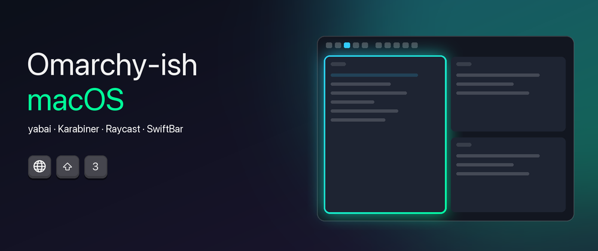
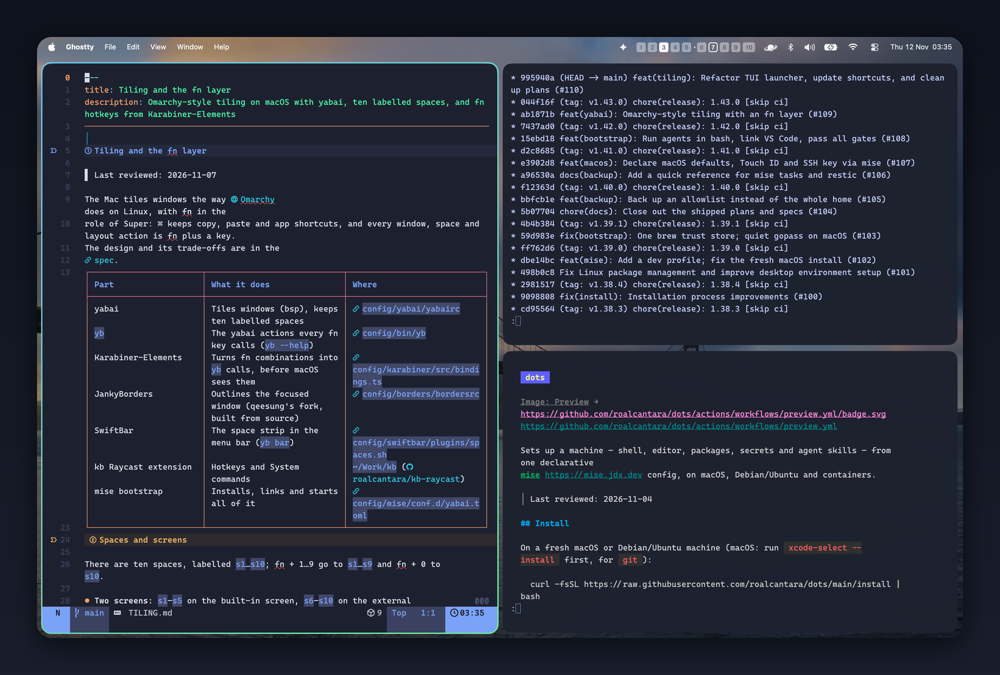
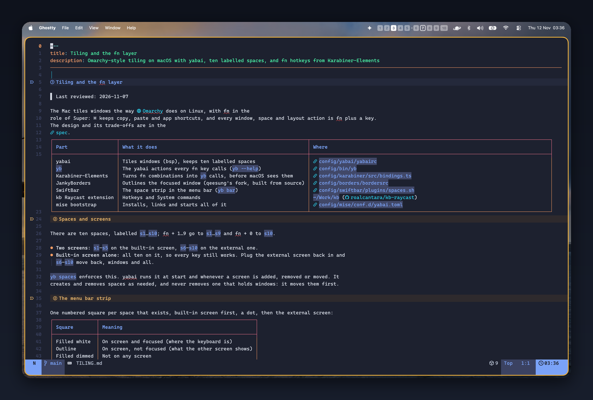
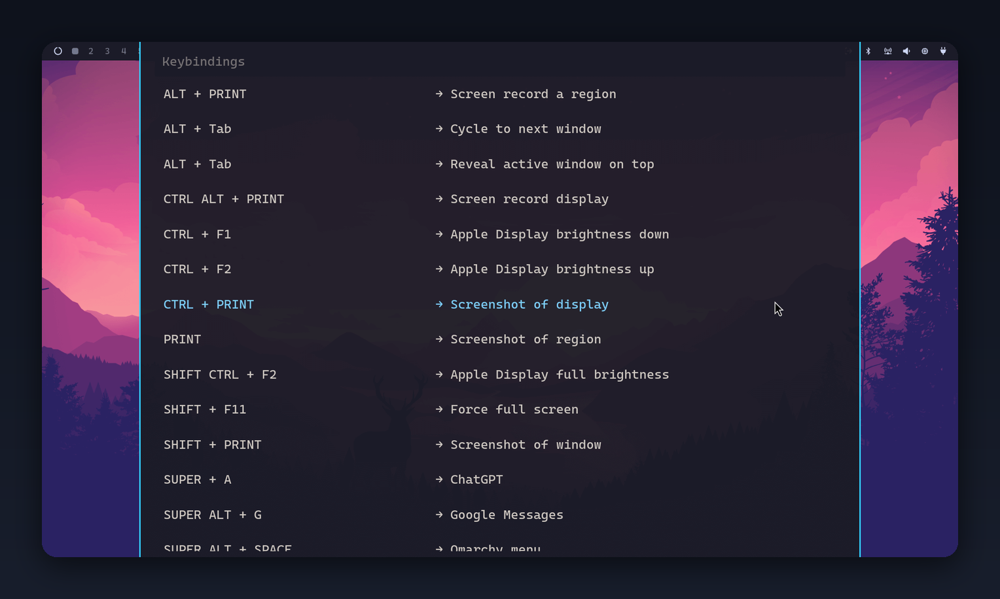
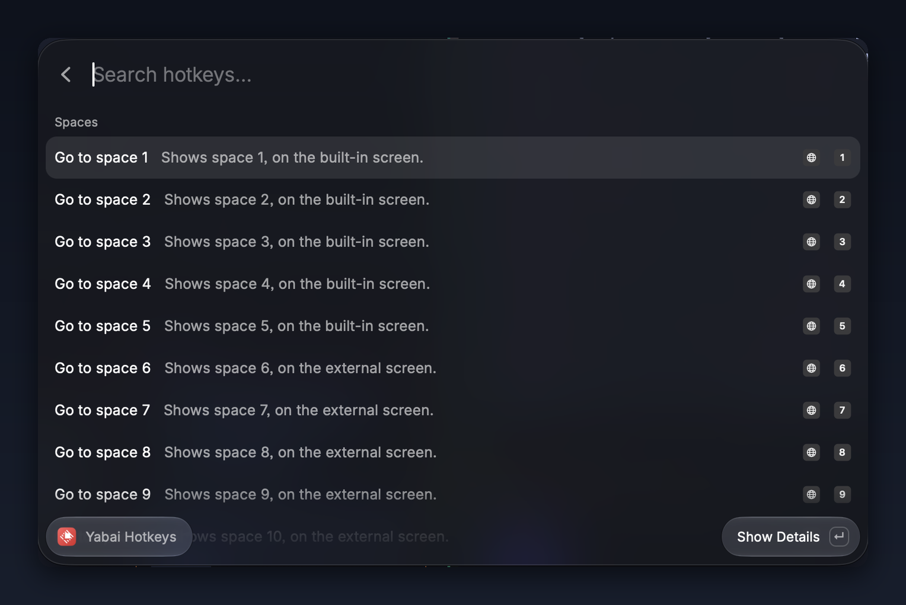
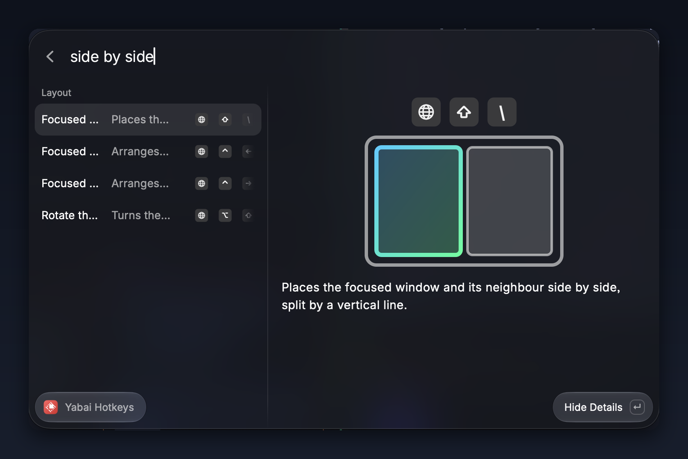
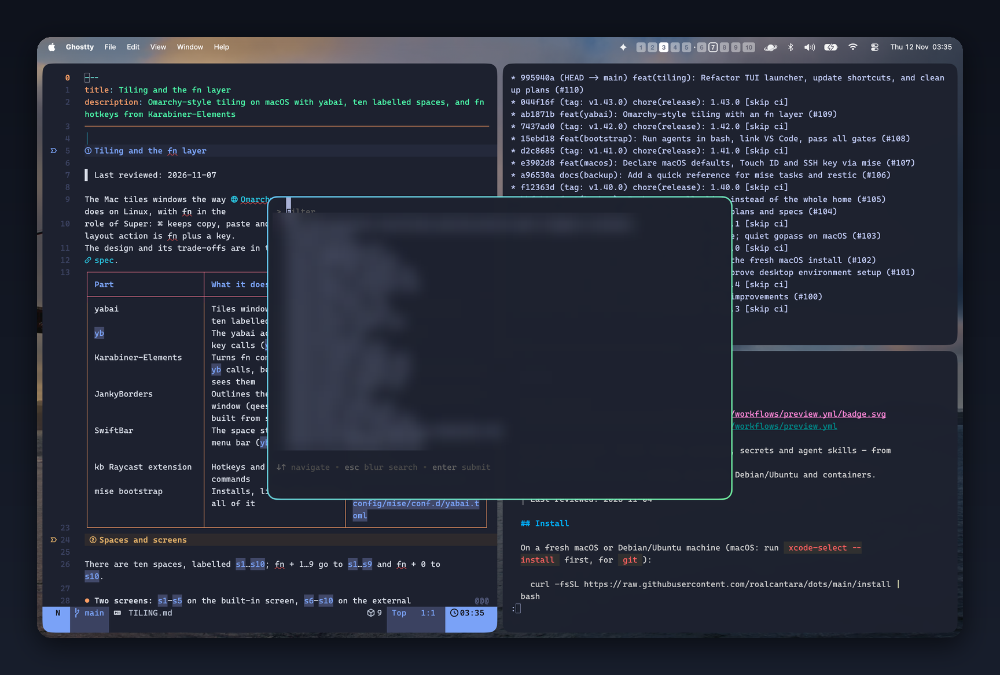

> **DISCLAIMER**
> This is not a tutorial. It is a tour of what (I think) I managed to build, with pictures.
> Everything lives in [my dotfiles](https://github.com/roalcantara/dots); use it with a grain of salt!



**OVERVIEW**

[Omarchy](https://omarchy.org) is a joy to drive without touching the mouse. Windows tile themselves. Every space is
one key away. One key shows every key. Small terminal tools pop up, do their thing and go away.

And then there is my Mac, where I drag windows by their title bars. :(

So this is the result of a few evenings of trying to bring that feeling to macOS, **without** fighting it: ⌘ still
copies, pastes and switches apps. Everything else lives one key away, behind `fn` (the 🌐 key).



### The pieces

| Piece | What it does here |
| --- | --- |
| [yabai](https://github.com/asmvik/yabai) | Tiles the windows (bsp) and keeps ten labelled spaces |
| [Karabiner-Elements](https://karabiner-elements.pqrs.org) | Turns `fn` + a key into a command, before macOS sees it |
| [JankyBorders](https://github.com/FelixKratz/JankyBorders) | Draws the outline around the focused window |
| [SwiftBar](https://github.com/swiftbar/SwiftBar) | Shows the spaces of each screen in the menu bar |
| [Raycast](https://www.raycast.com) | The hotkeys list and the TUI launcher |
| [Ghostty](https://ghostty.org) | The terminal, also for the pop-up TUIs |

Glueing them together is a small CLI called `yb` ([config/bin/yb](https://github.com/roalcantara/dots/blob/main/config/bin/yb)):
every `fn` key calls it, and it calls yabai.

---

**THE fn LAYER**

`fn` plays the role of Omarchy's Super key. Every window, space and layout action is `fn` plus one key:

- `fn 1…0` goes to a space; `fn ⇧ 1…0` sends the window there (and follows it).
- `fn ← → ↑ ↓` moves the focus; `fn ⇧ ←…` swaps windows.
- `fn f` zooms the window inside its space (the outline turns amber, so I always know).
- `fn ⏎` opens a terminal, `fn k` shows all of this.

The whole layer is one table in TypeScript
([bindings.ts](https://github.com/roalcantara/dots/blob/main/config/karabiner/src/bindings.ts)). A build step turns it
into Karabiner rules **and** into the list the hotkeys window reads, so the two can never disagree.



💡 macOS has its own ideas about `fn` (emoji picker, Dock, Quick Note…). Karabiner only takes over the combinations
the layer binds, so `fn e` still opens emojis and `fn q` now opens Raycast Notes instead of Quick Note.

---

**TEN SPACES, TWO SCREENS, ONE STRIP**

Spaces are labelled `s1…s10`: 1–5 on the built-in screen, 6–10 on the external one. Unplug the monitor and all ten
move to the laptop, windows and all. Plug it back and they go home.

The menu bar shows where I am: one square per space, a dot between the screens, the focused one filled.


---

**fn k: THE HOTKEYS WINDOW**

Omarchy has a lovely keybindings window. Mine is a Raycast command: every hotkey with a one-line description and its
keys drawn as key caps (🌐 included).





Press → and a pane opens with the keys drawn large and a tiny picture of what the hotkey does, in the spirit of
macOS's own window-tiling menu. The pictures are not hand-drawn: each hotkey says what *kind* of picture it is (say,
`split vertical`) and the extension draws it.



---

**TUIs, OMARCHY STYLE**

Omarchy opens small terminal tools (btop, lazygit…) in floating windows. Here, any tool listed in
[config/tuis.toml](https://github.com/roalcantara/dots/blob/main/config/tuis.toml) becomes a Raycast command that opens
it in its own Ghostty window: floating, centred on the screen I am on, focused, and gone when the tool quits.

```toml
[psc]
title = "Copy a secret"
command = "psc"
icon = "🔑"
```



One TUI at a time: opening another closes the current one. Esc stays with the tool, `q` (or picking something) closes
it.

---

**vs. OMARCHY**

| | Omarchy | This Mac |
| --- | --- | --- |
| Tiling | Hyprland, built in | yabai (needs its scripting addition for spaces) |
| Super key | Super | `fn` (🌐), via Karabiner |
| Keybindings window | Super + K | `fn k`, Raycast |
| TUIs | `omarchy-launch-tui` | `yb tui` + generated Raycast commands |
| Focus outline | Hyprland borders | JankyBorders |
| Status bar | Waybar | the macOS menu bar + SwiftBar |

What maps 1:1: the keys, the spaces, the TUIs. What macOS makes harder: everything that touches spaces needs yabai's
scripting addition (with SIP partly off), and every new macOS version is a small adventure.

---

**WHAT I (THINK I) LEARNED**

- **A new macOS breaks the scripting addition first.** On macOS 27 the released yabai refused to load it; a community
  fork did. So the build to use is now a per-machine choice (`yb use <path>`), not a hard-coded path.
- **A window can float from birth.** A one-shot yabai rule, added right before the window exists, floats and places
  it. No tiled flash, no moving it afterwards.
- **Focus is a race.** Raycast hands the focus back to the previous app as it closes, so the new window has to take it
  back.
- **One table, many outputs.** Karabiner rules, the hotkeys list and the docs' quick reference all come from the same
  table, and a test fails when one of them drifts. NO, SERIOUSLY: this is the part that keeps it maintainable.

---

**REFERENCES**

- [Omarchy](https://omarchy.org) and its [TUIs](https://omarchy.org/manual/tuis/)
- [yabai](https://github.com/asmvik/yabai) · [Karabiner-Elements](https://karabiner-elements.pqrs.org) ·
  [karabiner.ts](https://github.com/evan-liu/karabiner.ts)
- [JankyBorders](https://github.com/FelixKratz/JankyBorders) · [SwiftBar](https://github.com/swiftbar/SwiftBar) ·
  [Raycast](https://www.raycast.com) · [Ghostty](https://ghostty.org)
- My dotfiles: [the tiling and fn layer PR (#109)](https://github.com/roalcantara/dots/pull/109),
  [the TUI launcher PR (#110)](https://github.com/roalcantara/dots/pull/110) and
  [docs/TILING.md](https://github.com/roalcantara/dots/blob/main/docs/TILING.md)

Corrections and ideas are very welcome. :)
