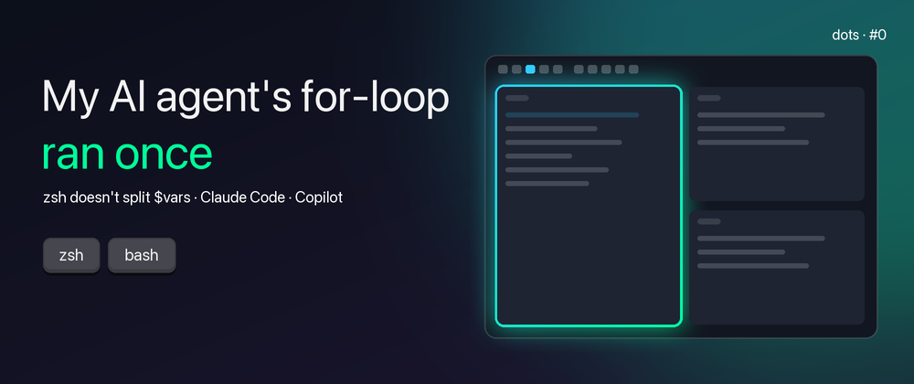
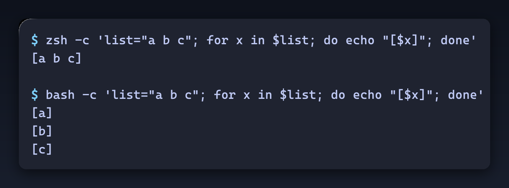

> **DISCLAIMER**
> This is not a tutorial. It is a small bug I (think I) understood, and the fix lives in
> [my dotfiles](https://github.com/roalcantara/dots). Use it with a grain of salt!



**OVERVIEW**

My coding agents' shell loops kept "working": no error, exit code 0, a confident summary at the end. Then I looked
at what they had actually done. A loop over a list of names had run once, over one string holding all of them.

Coding agents write shell the way most of the internet does: bash. On macOS, my login shell is zsh. And zsh doesn't
split an unquoted variable into words:

```console
$ zsh -c 'list="a b c"; for x in $list; do echo "[$x]"; done'
[a b c]
$ bash -c 'list="a b c"; for x in $list; do echo "[$x]"; done'
[a]
[b]
[c]
```

Same line, two shells, one silent difference. 💡 That is a zsh feature, not a bug: it saves you from a whole class
of quoting mistakes. It just isn't what the agent meant.



**RECIPE**

> **Use it when:** an AI agent's shell loops on macOS run once, or do less than they report.
> **You need:** bash from Homebrew (`brew install bash`); macOS's `/bin/bash` is 3.2, from 2006.

1. Claude Code: run its commands in bash — `"env": { "CLAUDE_CODE_SHELL": "/opt/homebrew/bin/bash" }` in
   `~/.claude/settings.json` (on an Intel Mac, the path is `$(brew --prefix)/bin/bash`: `/usr/local/bin/bash`)
2. GitHub Copilot chat in VS Code: give its terminal a bash profile —
   `"chat.tools.terminal.terminalProfile.osx": { "path": "/opt/homebrew/bin/bash", "args": ["-l"] }`
3. Keep zsh for yourself — your interactive terminal doesn't change.

⚠️ **Gotchas:** quoting (`"$list"`) doesn't help, it makes it one word in both shells · `setopt SH_WORD_SPLIT`
also fixes it, but for every script you run · the agent's bash reads `~/.bashrc`, not your `.zshrc`: activate your
tools there too (mine runs `mise activate bash`)
📁 **In dots:** [config/claude/settings.json](https://github.com/roalcantara/dots/blob/main/config/claude/settings.json) ·
[config/vscode/settings.json](https://github.com/roalcantara/dots/blob/main/config/vscode/settings.json) ·
[config/bash/bashrc](https://github.com/roalcantara/dots/blob/main/config/bash/bashrc) ·
[the PR (#108)](https://github.com/roalcantara/dots/pull/108)

**HOW IT WORKS**

- **Why the agent's command runs in zsh.** Claude Code runs its shell commands in your shell, and on macOS your
  login shell has been zsh since Catalina. Copilot chat in VS Code runs them in the integrated terminal, which is
  zsh too unless you give its tools another profile.
- **Why zsh does this.** In zsh, an unquoted `$list` stays one word unless you ask for splitting: `${=list}` splits
  once, `setopt SH_WORD_SPLIT` splits always. The zsh way to hold several items is an array, `list=(a b c)`. It is
  a deliberate design: in bash, forgetting quotes around a path with spaces is a classic bug; in zsh it can't happen.
- **What I changed** ([#108](https://github.com/roalcantara/dots/pull/108)): both tools now run their commands in
  Homebrew's bash 5, my `bashrc` activates mise so the agent finds the same tools I do, and my own terminal stays zsh.

**vs. MAKING THE AGENT WRITE ZSH**

| | Tell the agent "this is zsh" | Give the agent bash |
| --- | --- | --- |
| Effort | A line in every prompt or instruction file | One setting per tool, once |
| Reliability | Agents drift back to bash idioms | The idioms simply work |
| Your shell | Unchanged | Unchanged |

**WHAT I (THINK I) LEARNED**

- **"It ran without errors" is not "it worked".** The loop exited 0. Only the result told me.
- **My first fix was wrong.** I added quotes. In zsh that changes nothing, and in bash it breaks the split on purpose.
- **Agents inherit your environment, not your intentions.** Whatever your login shell does, they do.
- **Check which bash you get.** On macOS, a bare `bash` can be the 2006 one; point the setting at Homebrew's.

---

**REFERENCES**

- zsh FAQ: [Why does `$var` where `var="foo bar"` not do what I expect?](https://zsh.sourceforge.io/FAQ/zshfaq03.html#l18)
- [Claude Code settings](https://docs.anthropic.com/en/docs/claude-code/settings) ·
  [VS Code terminal profiles](https://code.visualstudio.com/docs/terminal/profiles)
- My dotfiles: [the PR that moved my agents to bash (#108)](https://github.com/roalcantara/dots/pull/108)

Corrections and ideas are very welcome. :)
