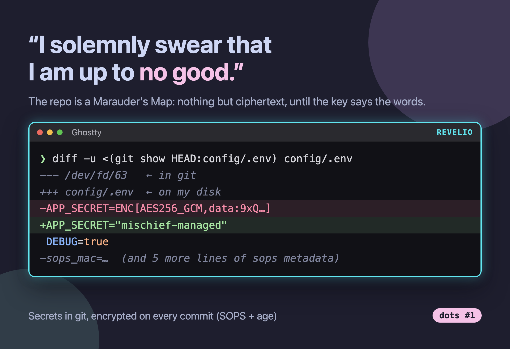

This month, researchers found real secrets in over a thousand public `.claude/settings.local.json` files on GitHub
([an explainer](https://dev.to/paullovelace/claude-codes-dont-ask-again-leaked-developers-secrets-to-public-github-explained-honestly-4dck)).

My dotfiles commit theirs on purpose: nine files, run through a git filter that encrypts them with SOPS + age on the
way in and decrypts them on the way out. Git decides which files by their path:

```console
$ git check-attr filter -- config/.env
config/.env: filter: sops
$ git ls-files ':(attr:filter=sops)' | wc -l
9
```

Every commit holds ciphertext (14 values of my `.env` are `ENC[AES256_GCM,…]` in git); my disk holds plain text.

## How I ran into it



On a brand-new Mac, the install cloned dots before it had asked for the age key, so every secret came out
encrypted. Then, with the key in place, every SOPS file still failed with `Failed to get the data key`: my scripts
looked for the key in `~/.config/sops/age/keys.txt`, and sops on a fresh Mac looked in
`~/Library/Application Support/sops/age/keys.txt`. :(

## The fix: a git filter and one key git never sees

Tell git which files go through the filter (dots adds SSH keys and a few configs the same way, each with a matching
rule in `.sops.yaml`):

```gitattributes
# .gitattributes
*.env filter=sops diff=sops
```

Tell SOPS which key encrypts them and, for `.env` files, which values (names that look secret; the rest stays
readable, so a diff still says which setting changed):

```yaml
# .sops.yaml
creation_rules:
  - path_regex: '.*\.env$'
    age: age1…   # the public key
    encrypted_regex: '^.*(SECRET|KEY|TOKEN|PASSWORD|PASS).*$'
```

Register the filter, once per clone (`mise run setup:git:filters` does it in dots). `required true` makes a commit
fail when the filter fails, instead of committing plain text:

```bash
git config --local filter.sops.clean 'script/clean.sops.sh %f'
git config --local filter.sops.smudge 'script/smudge.sops.sh %f'
git config --local filter.sops.required true
```

For readable diffs, a `textconv` decrypts what it can and prints the rest as it is (the working-tree side is already
plain), so `git diff` never fails. Never cache it: git would store the decrypted text.

```bash
git config --local diff.sops.textconv script/textconv.sops.sh
git config --local diff.sops.cachetextconv false
```

The smudge script is one line, `sops --decrypt --filename-override "$1" /dev/stdin`. The clean script encrypts,
with one twist: SOPS picks a new IV every time, so re-encrypting an unchanged file gives new bytes, and `git status`
called my secrets modified after every checkout. It now compares plain texts first
([the trick from getsops/sops#1137](https://github.com/getsops/sops/issues/1137)):

```bash
# script/clean.sops.sh (excerpt)
if [ "$hash_index" = "$hash_wt" ]; then
  cat "$enc_file"   # unchanged: reuse the committed blob
else
  sops --encrypt --filename-override "$path" "$wt_file"
fi
```

The key never enters git: `install` asks for it (hidden input) and writes `config/age/keys.txt` in the dots folder,
which `.gitignore` keeps out of every commit; `~/.config/sops/age/keys.txt` reaches it through a symlink. The other
copy is in my password manager. The scripts now point sops at that path, which fixed the fresh Mac:

```bash
AGE_KEY_FILE="${XDG_CONFIG_HOME:-$HOME/.config}/sops/age/keys.txt"
export SOPS_AGE_KEY_FILE="${SOPS_AGE_KEY_FILE:-$AGE_KEY_FILE}"
```

And `mise run setup:git:filters` checks the filtered files out again once the key exists, so a clone made before
the key turns plain. `-c filter.sops.clean=cat` skips the encrypt step on the still-encrypted copy, so only the
smudge (decrypt) runs:

```bash
git -c filter.sops.clean=cat checkout -- config/.env
```

Check it: a clean status, and ciphertext in the commit.

```console
$ git status --short
$ git show HEAD:config/.env | grep -c 'ENC\[AES256_GCM'
14
```

And **presto!** Secrets versioned with everything else, and nothing readable in history.

## Why not something simpler?

- **Just `.gitignore` them:** that keeps them out of git, and out of my backups and history too. My global ignore
  does that for files that should never be committed, like `.claude/settings.local.json`
  ([config/git/ignore](https://github.com/roalcantara/dots/blob/main/config/git/ignore)); secrets I want versioned
  go through the filter.
- **Commit SOPS-encrypted files by hand** ([GitGuardian's SOPS guide](https://blog.gitguardian.com/a-comprehensive-guide-to-sops/)
  shows this): it works, but I'd have to remember to encrypt before every commit. The filter can't forget.
- **git-crypt, transcrypt or [git-agecrypt](https://github.com/vlaci/git-agecrypt):** all encrypt whole files
  ([a comparison](https://havenmessenger.com/blog/posts/encrypted-git-repositories-compared/)), so a diff can't show
  which setting changed. git-agecrypt is the closest: age, with the diff and "always modified" parts built in.

## What I (think I) learned

- **Encryption that isn't deterministic fights git.** A new IV on every run looks like a change on every status.
- **A fresh machine is the real test.** Mine cloned before the key existed, and sops looked for the key elsewhere.
- **The key is the one thing dots can't restore** (err.. by design). It lives in my password manager, and that's it.
- **A copied config line can hide for months.** My first diff setting, `diff.sops.command … %f`, made `git diff`
  hang on any changed secret for ten months: git calls a diff command with seven arguments, not one
  ([git's `GIT_EXTERNAL_DIFF`](https://git-scm.com/docs/git#Documentation/git.txt-GITEXTERNALDIFF)). A
  review of this very post found it.

The setup lives in my dotfiles: [.gitattributes](https://github.com/roalcantara/dots/blob/main/.gitattributes),
[.sops.yaml](https://github.com/roalcantara/dots/blob/main/.sops.yaml),
[the filter scripts](https://github.com/roalcantara/dots/tree/main/script) and
[the fix for the fresh Mac](https://github.com/roalcantara/dots/pull/102).

References: [Red Hat on clean/smudge filters](https://developers.redhat.com/articles/2022/02/02/protect-secrets-git-cleansmudge-filter),
[SOPS + age + git](https://devops.datenkollektiv.de/using-sops-with-age-and-git-like-a-pro.html),
[getsops/sops#1137](https://github.com/getsops/sops/issues/1137),
[age#507](https://github.com/FiloSottile/age/discussions/507) and
[git's textconv](https://git-scm.com/docs/gitattributes#_performing_text_diffs_of_binary_files).

---

Corrections and ideas are very welcome. **NO, SERIOUSLY!** :)

> **DISCLAIMER**
> This is not a tutorial. It is what I (think I) learned, and it lives in [my dotfiles](https://github.com/roalcantara/dots).
> **PLEASE:** use it with a grain of salt! **YOU HAVE BEEN WARNED!**

Drafted with AI help; every claim was checked by me, and the story is mine.
