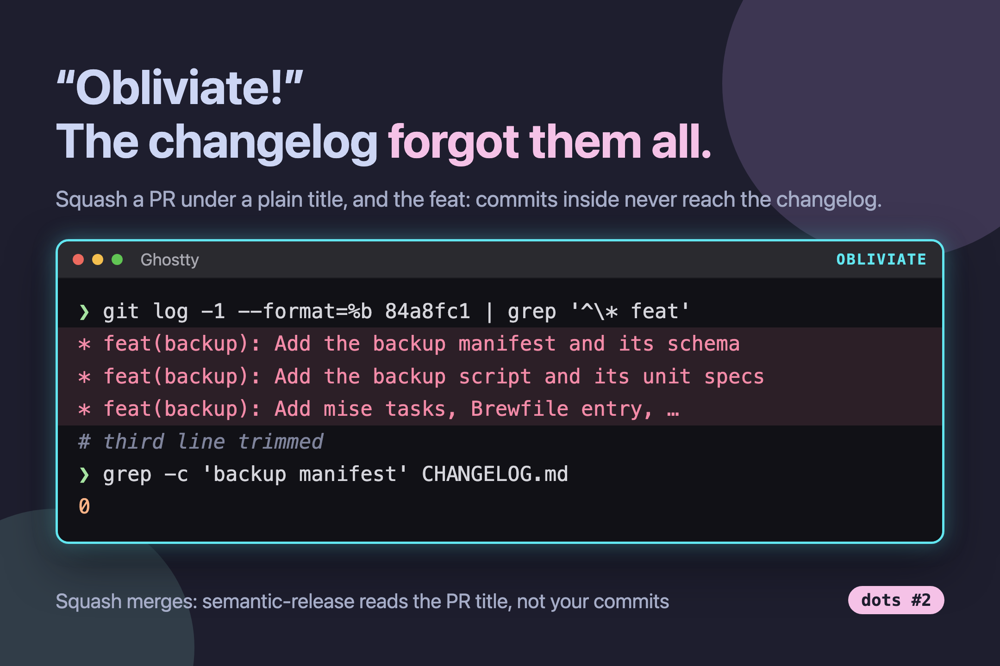
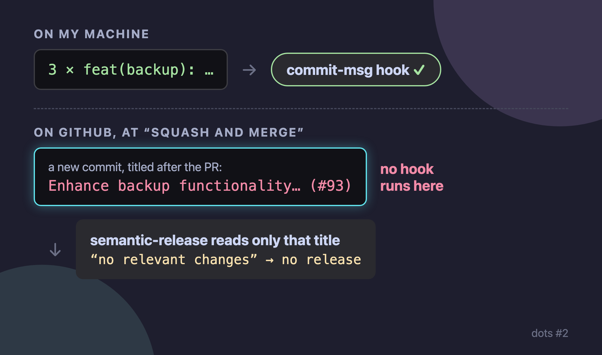

If you write [Conventional Commits](https://www.conventionalcommits.org/en/v1.0.0/) and let
[semantic-release](https://github.com/semantic-release/semantic-release) cut your versions, the commit subject is
the whole contract: `feat:` bumps the minor version, `fix:` the patch, and each subject becomes a changelog line.
Squash-merge a pull request with two or more commits, and GitHub writes **one** commit
[titled after the pull request](https://docs.github.com/en/repositories/configuring-branches-and-merges-in-your-repository/configuring-pull-request-merges/configuring-commit-squashing-for-pull-requests).
That title is all semantic-release reads..

```console
$ git log -1 --format=%s 84a8fc1
Enhance backup functionality and update documentation (#93)
$ gh run view 41811286816 --log | grep -o 'There are.*'
There are no relevant changes, so no new version is released.
```

Three `feat(backup):` commits went into that pull request. None of them made a release, and the job passed.

## How I ran into it



My commits were fine. My pull request titles weren't: a tool wrote them ("Enhance…", "Improve…", "Fix…"), I
squash-merged six of them in a week, and I only noticed afterwards. :(

The numbers, from my dotfiles' history (Oct 29 to Nov 5):

```console
$ git log --first-parent --format=%s v1.36.0..v1.39.0 \
    | grep -vE '^[a-z]+(\(.+\))?!?: ' | cut -c1-54
Fix Linux package management and improve desktop envir
Implement age-key unlock and enhance gopass keyring ha
Refactor repo close-out, restore skills, and clean up
Enhance backup functionality and update documentation
Improve README formatting and update CLI configuration
Enhance mise bootstrap with native integration and sec
```

Those six squash commits held 133 commits, 68 of them `feat` or `fix`. **67 of the 68 never reached
`CHANGELOG.md`**, and five of the six release runs ended with "no relevant changes". Green, every one.

## The fix: one format, and a merge that keeps it

**1. One format for every subject.** My rules live in
[CONTRIBUTING.md](https://github.com/roalcantara/dots/blob/main/docs/CONTRIBUTING.md); the type is what
semantic-release reads, the rest keeps the release notes readable:

```text
<type>[optional scope]: <Description>

feat(backup): Add the backup manifest and its schema
fix(hk): Detect lowercase subjects in any locale
```

With the `conventionalcommits` preset: `feat` → minor, `fix` and `perf` → patch, `feat!:` or `BREAKING CHANGE:` in
the footer → major. `docs`, `chore`, `test` and the rest release nothing.

**2. The release config.** Three plugins: read the commits, write the notes, publish them as a GitHub Release.
Nothing is committed back, so the Releases page is the changelog:

```yaml
# .releaserc.yml
branches:
  - main
preset: conventionalcommits
plugins:
  - '@semantic-release/commit-analyzer'
  - '@semantic-release/release-notes-generator'
  - - '@semantic-release/github'
    - failComment: false
```

**3. The job, on every push to `main`.** It needs the whole history (`fetch-depth: 0`) to find the last tag, and it
installs a pinned semantic-release from a lockfile (`.github/release/package.json` pins `semantic-release` 25.0.9):

```yaml
# .github/workflows/release.yml (excerpt)
concurrency:
  group: release-${{ github.ref }}
  cancel-in-progress: false
# …
- uses: actions/checkout@<sha> # v7.0.1
  with:
    fetch-depth: 0
    persist-credentials: false
- uses: actions/setup-node@<sha> # v7.1.0
  with:
    node-version: '26'
- run: npm ci --ignore-scripts --prefix .github/release
- run: .github/release/node_modules/.bin/semantic-release
  env:
    GITHUB_TOKEN: ${{ secrets.GH_TOKEN }}
```

A personal token, not the default one: a Release created with `GITHUB_TOKEN` starts no other workflow, and mine
builds Docker images on `release: published`.

**4. Merge so the commits survive.** Since
[#111](https://github.com/roalcantara/dots/pull/111) I merge with a merge commit, so semantic-release reads every
commit on the branch (it skips the `Merge pull request…` line). If you'd rather squash, the pull request title
**is** the commit: write it in the same format, `feat(backup): Back up an allowlist…`, as I did from
[#102](https://github.com/roalcantara/dots/pull/102) on.

Check it before a release: list what the analyzer will skip since the last tag.

```console
$ git log --no-merges --format=%s \
    "$(git describe --tags --abbrev=0)"..HEAD \
    | grep -vE '^[a-z]+(\(.+\))?!?: '
```

It works with either merge style: `--no-merges` skips the `Merge pull request…` line and lists the branch's
commits, or the squash titles. No output, no surprise. And **presto!** 88 releases since July 2025, and every line of
the notes is a commit subject I (or an agent) wrote.

## Why not a commit-msg hook?

It wouldn't have caught it: every commit I wrote was fine.



The broken one was the commit GitHub wrote when I pressed *Squash and merge*: titled after the pull request,
created on GitHub's side, after every local hook had already run. A hook checks what you type; it never sees what
the merge button types.

(I had one anyway, and dropped it on Nov 4: it lived in my global hk config and broke commits in every repo where
[cog](https://github.com/cocogitto/cocogitto) wasn't installed ([#96](https://github.com/roalcantara/dots/pull/96)).)

## What I (think I) learned

- **A green release job can mean "did nothing".** "No relevant changes" is a success, not a warning.
- **With squash merges, the PR title is the commit.** Review it like one.
- **My mistake: I let a tool title the pull requests** and never read the release log. Those 67 entries stay
  missing; I didn't rewrite history to add them.
- **Another mistake: the job installed semantic-release unpinned.** v26 went stable on Nov 16
  ([its release](https://github.com/semantic-release/semantic-release/releases)) and my next release ran it
  without a line changed here. It worked, but it was luck; it's pinned now, behind a lockfile.
- **A committed changelog can duplicate itself.** The old setup committed `CHANGELOG.md` before pushing the tag;
  when a tag push failed, the next run wrote the same version again (two `1.38.1` sections, twelve `1.17.0`). The
  GitHub Release is the changelog now ([ADR 0001](https://github.com/roalcantara/dots/blob/main/docs/adr/0001-releases.md)).
- **A limit:** the tag is still pushed before the Release is created. If a run fails in between, the next run fails
  on purpose and names the tag, and I create that Release by hand.

The setup lives in my dotfiles: [.releaserc.yml](https://github.com/roalcantara/dots/blob/main/.releaserc.yml),
[the release workflow](https://github.com/roalcantara/dots/blob/main/.github/workflows/release.yml),
[ADR 0001](https://github.com/roalcantara/dots/blob/main/docs/adr/0001-releases.md) and
[the releases](https://github.com/roalcantara/dots/releases).

---

Corrections and ideas are very welcome. **NO, SERIOUSLY!** :)

> **DISCLAIMER**
> This is not a tutorial. It is what I (think I) learned, and it lives in [my dotfiles](https://github.com/roalcantara/dots).
> **PLEASE:** use it with a grain of salt! **YOU HAVE BEEN WARNED!**

Drafted with AI help; every claim was checked by me, and the story is mine.
